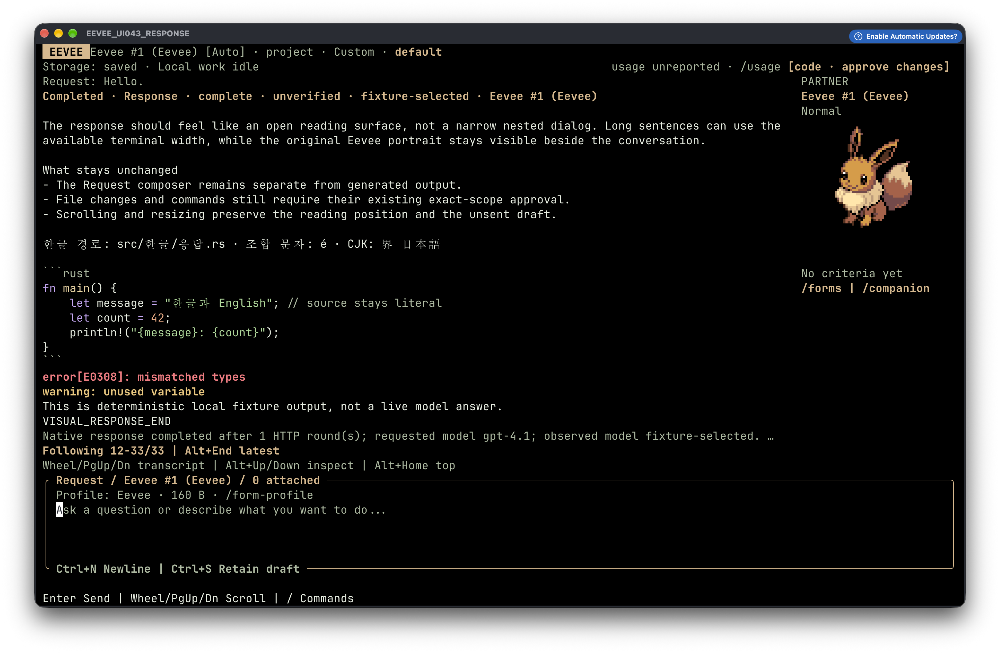

<div align="center">


<h1>
  <picture>
    <source media="(prefers-color-scheme: dark)" srcset="docs/assets/wordmark-dark.png">
    
  </picture>
</h1>

**A local-first coding agent for your terminal — bring any model, review every change.**

[](https://github.com/kimmandoo/eevee/actions/workflows/native.yml)
[](https://github.com/kimmandoo/eevee/releases/latest)
[](LICENSE)
[](Cargo.toml)


[Install](#install) · [Quick start](#quick-start) · [Providers](#providers) · [Safety model](#safety-model) · [Build from source](#build-from-source) · [Contributing](#contributing)

</div>

---

<p align="center">
  
  <br>
  <sub>Actual <code>ev 0.1.33</code> in Ghostty 1.3.1 on macOS: Eevee is rendered as native pixels, not text or a composited overlay. This isolated first-launch capture made no provider/model request. <a href="docs/ASSET_LICENSES.md">Artwork attribution and rights limits.</a></sub>
</p>

`ev` is a single native binary that turns any folder into an agent workspace. Type a request; the model you connected reads your project, writes files, runs builds and tests, reads the real errors and fixes them — the same loop you know from Codex or Claude Code, with any provider and with every effect shown to you first.

It also happens to come with a companion: a party of Eevee forms that evolve with the kind of work you do. Purely cosmetic — every form can code.

## Highlights

- **Any model.** OpenAI (account or API), Anthropic, Google Gemini, and any OpenAI-compatible endpoint — including local servers like Ollama, vLLM and LM Studio. External agents (Codex, Claude Agent SDK, OpenCode / Gemini / Devin over ACP) work too.
- **A real coding loop.** Discover, read, create, edit, rename and delete files; run builds, tests and programs; feed actual output back to the model. Generated code streams into the transcript as it is written.
- **Review, or auto-approve.** Each file change and command opens a compact review with the exact diff or argv. When you trust the run, `/auto-approve` (or **Shift+A** in a review) lets the rest of the task proceed without prompts.
- **Local-first.** Tasks, drafts, transcripts and run history live in local SQLite. No account, server or Node runtime needed — the workspace works offline until you connect a model.
- **Built for the terminal.** Rust + ratatui, works from 60×18 up, mouse and keyboard, Kitty/Sixel sprites with text fallback, ASCII/mono modes.
- **Cross-platform.** macOS (arm64, x86_64), Linux and WSL (x86_64, arm64), Windows (x86_64). Every target is built and tested in CI.

## Install

**macOS / Linux / WSL**

```sh
curl -fsSL https://github.com/kimmandoo/eevee/releases/latest/download/install.sh | sh
export PATH="$HOME/.local/bin:$PATH"
```

**Windows (PowerShell 5.1 / 7, no admin)**

```powershell
& ([scriptblock]::Create((irm https://github.com/kimmandoo/eevee/releases/latest/download/install.ps1)))
$env:PATH = "$env:LOCALAPPDATA\ev\bin;" + $env:PATH
```

Installers verify SHA-256 checksums and never edit your shell profile or persistent `PATH`. Prebuilt archives and checksums are on the [releases page](https://github.com/kimmandoo/eevee/releases/latest); see [offline and pinned installs](#offline-and-pinned-installs) below.

```sh
ev update --check   # see whether a newer release exists
ev update           # upgrade in place
ev uninstall        # remove the binary; your data stays
```

> [!IMPORTANT]
> Before upgrading, exit every running `ev` and back up the **whole data directory**. Data formats can change between versions even when the schema number does not; `ev` refuses data it cannot read safely rather than converting it.

### Offline and pinned installs

<details>
<summary>Pinned versions, offline archives and persistent PATH</summary>

Pin a version:

```sh
curl -fsSLo install-ev.sh https://github.com/kimmandoo/eevee/releases/latest/download/install.sh
sh ./install-ev.sh --version v0.1.34
```

```powershell
& ([scriptblock]::Create((irm https://github.com/kimmandoo/eevee/releases/latest/download/install.ps1))) -Version v0.1.34
```

Offline: download the matching archive, `SHA256SUMS` and installer from one release, then:

```sh
sh ./install-ev.sh --archive ./ev-linux-x86_64.tar.gz --checksums ./SHA256SUMS
```

```powershell
powershell -NoProfile -ExecutionPolicy Bypass -File .\install.ps1 -Archive "$PWD\ev-windows-x86_64.zip" -Checksums "$PWD\SHA256SUMS"
```

To keep `ev` on `PATH`, add `export PATH="$HOME/.local/bin:$PATH"` to your shell profile, or on Windows add `%LOCALAPPDATA%\ev\bin` to your user `Path`. macOS builds are not notarized; WSL uses the Linux packages.

</details>

## Quick start

```sh
cd your-project
ev
```

1. **Connect** — `/connect`, pick a provider, pick a model. Setup never sends your draft.
2. **Ask** — type what you want and press **Enter**:
   > Create a snake game in Python, run it, and fix anything that breaks.
3. **Review** — file changes and commands appear for review automatically. Allow once, deny, or press **Shift+A** to allow the rest of this task.

The folder you launch from is the project boundary. Git is optional. No `/init` is required; `/init` only drafts an `AGENTS.md` guide for the project if you want one.

### Native connections and conversation context

Native Responses uses one WebSocket connection across a Run's model/tool rounds on the official public OpenAI API. Other native routes keep HTTP by default. Use `ev --native-transport http` to select HTTP explicitly, or `ev --native-transport websocket` for a supported Responses route; unsupported routes refuse rather than switching transports.

Each new explicit Send opens a fresh request and carries only the existing completed public conversation. A retained socket is not a durable provider session, and partial/unknown output is not admitted as completed context. There is no automatic reconnect, retry or replay. WebSocket transport refuses ambient proxy configuration and custom TLS trust on secure `wss://` connections; choose HTTP explicitly when required. TLS-root settings do not affect permitted cleartext loopback `ws://` connections.

Responses retain their own outcome and context-admission status after later requests. An external agent process disconnect opens the existing diagnostics path without resending the request or exposing raw process output.

### Everyday controls

| Want to… | Use |
| --- | --- |
| Find any action | `/` or **Ctrl+K** |
| Connect / switch model / reasoning effort | `/connect` · `/model` · `/effort` |
| Attach a file or line range as context | `@` → pick → **Enter** (**r** for a range) |
| Auto-approve for this task / stop | `/auto-approve` · `/auto-approve-off` |
| Reopen a deferred review | **Alt+A** or `/approvals` |
| Read earlier output | wheel or **PgUp/PgDn**; **Alt+End** follows live output |
| Run your own command | `/command-edit` → `/execute`; history in `/run` |
| Restrict which files may be written | `/paths` (`[]` clears it) |
| Plan without writing | `/role-plan`, or say "read only" |
| Start a fresh chat / new task | `/chat-new` · `/reset` · `/tasks` |
| Cancel / quit safely | `/cancel` · `/cancel-all` · `/quit` |

### One request flow across connections

`/journey` shows the same model/effort → Request → preview → Send → stream → approvals → progress → follow-up → cancel → resume/new → handoff path for every connection. Missing capabilities stay visible in place; changing a model never silently switches routes, sends a draft or restores approval. Requested effort and provider acknowledgment are separate; missing usage stays unknown.

`/effort auto` chooses reasoning effort locally for each explicit Send from how open-ended the request is, not its length. `/evolution-preview` shows the resolved effort and rule before sending. Ordinary automatic choices stop one advertised tier below the top; a standalone lowercase prose `ultrathink` requests the top for that request only. Code, quoted text, paths and identifiers do not trigger it. Fixed effort selections keep their existing behavior; unsupported effort control is disclosed, not fabricated.

`/todo` opens the task's structured provider progress. **e** edits bounded step JSON; **a** or `/todo-adopt` adopts the inspected revision. A later provider revision needs review and re-adoption. In automatic form mode, an ambiguous explicit follow-up such as `continue` can follow the adopted active step; an explicit request, read-only policy or pinned form wins. Progress is a provider claim, never verification or completed criteria. Nothing continues automatically. `/todo-eager on` optionally adds a disclosed phased-list instruction to native requests; it is off by default.

The response shows one readable todo card per request as valid updates arrive, with step markers and completion counts instead of repeated argument JSON. Refused/malformed observations stay visible; `/verbose` exposes the original tool observations. File code follows actual incoming source fragments with a numbered live tail—no artificial typing delay. File decisions stay in a small panel immediately above Request, preserving your future draft. Choose Deny or Allow once deliberately; long path/directory scope must be reviewed before allowing, and `d` opens the full change.

```sh
ev --theme light          # light palette
ev --ascii --color mono   # plain terminals
ev --no-animation         # static indicators
ev --data-dir /abs/path   # separate, isolated storage
ev --help
```

### Retained work and long requests

Public0.1.34 includes:

| Want to… | Use |
| --- | --- |
| Search saved work in this project, offline | `/project-search <literal>`; **Tab** includes archived tasks |
| Inspect a partner's attributed outputs | `/partner-summary` or `/routes` → **c** |
| Keep separate unsent follow-ups | `/park-draft` · `/drafts`; restore never sends |
| Label a retained response | `/retained-responses` → **Enter** → **l**; revisit with `/landmarks` |
| Edit the current Request externally | `/external-edit`; review launch, then review returned text |

External editing waits for all work and saves to settle. Set `VISUAL` (preferred) or `EDITOR` to one executable, or a JSON argv array such as `["code","--wait"]`. No shell syntax or placeholders are expanded. Configure the editor to save in place: replaced files, links, unsafe/oversized output and cleanup failures are refused. The Request is exported as plaintext and may contain secrets; the unsandboxed editor inherits your environment, which may contain credentials, and may retain its own copies. Importing text does not send it.

Parked drafts, landmarks, adopted progress and typed auto effort use strict reader admission. Since0.1.33, admitted SQL0–19 data migrates to SQL20 for retained screenshots, and structured todo events require complete SDK bridge11; replace sidecar source/policy/dependencies together. TM1/formation2 remain unchanged. Back up the whole data directory before upgrading. Public0.1.32 refuses SQL20; a matching version number is not a reader/rollback compatibility guarantee.

### Reviewed images and selected local commits

`/screenshot` asks for one literal project-relative PNG/JPEG path. Read every disclosure page, then **Enter** attaches it locally without sending. The Request title shows the selected image and compressed byte count; the next ordinary explicit Send includes its original bytes. `/screenshot-show` inspects metadata, `/screenshot-remove` deselects but retains bytes, and `/screenshot-purge` reviews deletion of the retained capture. Storage failure blocks Send; `/screenshot-retry` retries storage only.
A different capture requires purging the retained one first; removal alone does not replace its bytes.

Images are bounded to2MiB compressed,4096 pixels per axis,8,388,608 pixels and32MiB decoded. Source containment, exclusions, no-link policy, current bytes and request-body bounds are rechecked. Only explicitly qualified native OpenAI/compatible Responses routes and known image-capable model IDs are supported; unknown routes/models and other adapters refuse. Terminal metadata is **not visual review**: inspect the original yourself. Eevee cannot reliably detect/redact image secrets. Image-token cost remains unknown unless reported; local purge is not secure erasure or provider deletion. Task export does not include image bytes; full-directory backup does.

`/commit-edit` uses the existing Command editor. Author strict JSON, then `/execute` opens the paged one-shot review:

```json
{"selected_commit":["src/main.rs"],"message":"Describe this local change"}
```

This locally commits only the1–64 selected whole files (8MiB each/32MiB total; message up to16KiB). It requires stable Git2.x>=2.36, an ordinary SHA-1 repository with a native `.git` directory, an existing local branch, a clean initial index, no merge/conflict state and repository-local `user.name`/`user.email`. Hooks, attributes/filters, CRLF conversion, signing and executable helpers are bypassed under the disclosed raw-byte plumbing semantics. Global/inherited Git configuration is not imported. Unsupported states and HEAD/source/index/configuration drift refuse.

The operation requires exclusive project write ownership and fresh complete-scope approval; provider tools, standing auto-approval and retained rerun cannot authorize it. Other dirty worktree bytes remain untouched. `/run` retains actual commit/ref/index outcomes, including partial/unknown publication and possible unreachable objects—not verification or automatic task completion. There is no push, authentication, automatic retry/reset or rollback claim.


## Providers

| Connection | How |
| --- | --- |
| **OpenAI account** | Browser or device login inside `ev`; no Codex install needed |
| **OpenAI API** | API key in setup, or `OPENAI_API_KEY` |
| **Anthropic** | API key in setup, or `ANTHROPIC_API_KEY` |
| **Google Gemini** | API key in setup, `GEMINI_API_KEY` or `GOOGLE_API_KEY` |
| **OpenAI-compatible / local** | Endpoint, model, protocol (Chat Completions or Responses), optional key. HTTPS required except loopback |
| **External agents** | Codex app-server, Claude Agent SDK sidecar (Node 24+), OpenCode / Gemini / Devin via ACP |

The method you choose decides the transport — `ev` never silently falls back to another account, billing route, protocol or model. Exact custom model IDs work even when the provider's model list is unavailable. Credentials are session-only by default; opting in stores them as owner-private plaintext under `~/.eevee-connections/` (not an OS keychain).

Details, limits and per-route enforcement: [Agent compatibility](docs/AGENT_COMPATIBILITY.md).

## Safety model

`ev` mediates the native tools it gives the model. In short:

- **Files** — every create/edit/rename/delete is frozen against the exact bytes and paths it will touch, then reviewed. Edits of existing files show just the changed region. Stale content, links, protected paths and your exclusions are refused. Up to 1024 files per request, 4 MiB each.
- **Commands** — shown as a readable argv with working directory and resolved executable before they run. Nonzero, cancelled or unknown outcomes are never reported as success, and nothing is replayed automatically.
- **Auto-approve** — an explicit, visible (`AUTO-APPROVE` in the header), in-memory grant for the current partner and task only. Questions still ask; task change or restart ends it.
- **Ownership** — approvals belong to the request that asked. Evolution, restart and saved settings never restore a grant.

> [!WARNING]
> Commands run with your user's permissions and inherited environment. `ev` is **not an OS sandbox**: an approved command can touch anything you can. External agents' own tools follow their own policies. Cancellation stops work but does not roll back completed effects.

Your data lives in `~/.local/share/eevee` (Linux), `~/Library/Application Support/eevee` (macOS) or `%LOCALAPPDATA%\eevee` (Windows). Keep it outside your project tree. Full contracts: [Design rules](docs/DESIGN_RULES.md).

## The party

Your companion is more than decoration — but never a permission system.

- **Nine forms** chosen automatically from what you ask (or pinned manually), with a small evolution moment when the specialty changes.
- **Local intent routing** recognizes English/Korean UI and tool improvements, including inspection followed by an explicit fix. Appearance and capability remain separate: a diagnosis-and-fix can keep Umbreon while requesting approved implementation; manual appearance and explicit Plan/Review remain protected. Inspect `/evolution-preview` before Send.
- **Party and cooperation** — up to three partners can work on one task with separate drafts and approvals; only one may edit at a time.
- **Moves and TMs** — save reusable steps per form, export/import them as portable TOML.
- **Held context, formations, ribbons and records** — remember files and notes, save party setups, and browse source-linked history.

Sprites render via Kitty/Sixel when supported; installers fetch artwork separately and source builds can run `ev --download-artwork`.

## Build from source

Requires **Rust 1.90**.

```sh
git clone https://github.com/kimmandoo/eevee.git
cd eevee
cargo build --locked --release
./target/release/ev
```

Run the same checks as CI:

```sh
cargo fmt --all -- --check
cargo clippy --locked --all-targets --all-features -- -D warnings
cargo test --locked --all-targets --all-features
npm ci --ignore-scripts --no-audit --no-fund --prefix sidecar && npm test --prefix sidecar   # optional Claude SDK bridge
```

End-to-end terminal journeys live in `scripts/*_smoke.py` (needs `pyte==0.8.2` and `wcwidth==0.2.13`). They drive the real binary in a PTY against deterministic local protocol peers, so they need no API keys:

```sh
python scripts/native_workflows_smoke.py --binary target/release/ev --output /tmp/ev-proof --profile full --jobs 2
```


## Contributing

Issues and pull requests are welcome.

- **Bugs:** include your OS, terminal and size, `ev --version`, provider route, and what you expected versus saw. Never paste credentials or private task data.
- **Changes:** keep `fmt`, `clippy` and `test` green, add behavior-focused tests, and add an entry to [CHANGELOG.md](CHANGELOG.md). Commit messages follow `type(scope): subject`, e.g. `fix(files): refuse aliased parents`.
- **Contracts:** [docs/DESIGN_RULES.md](docs/DESIGN_RULES.md) is binding. Changes that touch approvals, storage, cancellation or provider boundaries should update it in the same PR.
- **UI text** lives in `messages/` and is compiled into the binary.

| Docs | For |
| --- | --- |
| [Design rules](docs/DESIGN_RULES.md) | Product behavior, privacy and lifecycle contracts |
| [Agent compatibility](docs/AGENT_COMPATIBILITY.md) | Providers, transports and enforcement limits |
| [Troubleshooting](docs/TROUBLESHOOTING.md) | Terminal, install and runtime problems |
| [Implementation plan](docs/IMPLEMENTATION_PLAN.md) · [Roadmap](task.md) | Architecture and upcoming work |
| [Changelog](CHANGELOG.md) | What changed, release by release |

## License and attribution

Original code, prose and the geometric wordmark are licensed under **[Apache-2.0](LICENSE)**. See [NOTICE](NOTICE) and [asset attribution](docs/ASSET_LICENSES.md). The wordmark has an editable [SVG source](docs/assets/wordmark.svg).

Pokémon sprites are third-party artwork from a [pinned PokéAPI revision](https://github.com/PokeAPI/sprites/tree/0dc105d5b12416932f29b594078282ab4be045f5); its [notice](https://github.com/PokeAPI/sprites/blob/0dc105d5b12416932f29b594078282ab4be045f5/LICENCE.txt) attributes image copyright to **The Pokémon Company**. Native packages contain no franchise image bytes. The documentation screenshot shows rendered third-party artwork, excluded from Apache-2.0; see [capture provenance and rights limits](docs/ASSET_LICENSES.md). Display, downloads and the software license grant no image, trademark or commercial-use rights.

**Independent and unofficial; no affiliation or endorsement.**
