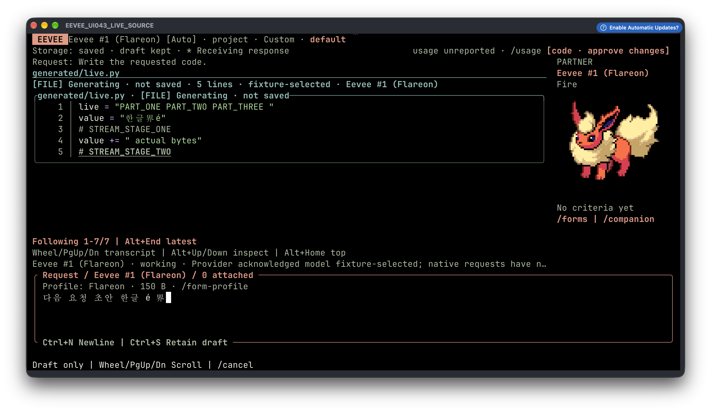

<div align="center">


<h1>
  <picture>
    <source media="(prefers-color-scheme: dark)" srcset="docs/assets/wordmark-dark.png">
    
  </picture>
</h1>

**A local-first coding agent for your terminal — bring any model, review every change.**

[](https://github.com/kimmandoo/eevee/actions/workflows/native.yml)
[](https://github.com/kimmandoo/eevee/releases/latest)
[](LICENSE)
[](Cargo.toml)


[Install](#install) · [Quick start](#quick-start) · [Meet the party](#meet-the-party) · [Providers](#providers) · [Safety model](#safety-model) · [Build from source](#build-from-source) · [Contributing](#contributing)

</div>

---

<p align="center">
  
  <br>
  <sub>Actual macOS/Ghostty capture; Eevee is native terminal pixels, not pasted into the screenshot. Response text comes from a deterministic loopback fixture, not a live model. No account or paid provider was used. <a href="docs/ASSET_LICENSES.md">Artwork attribution and rights limits.</a></sub>
</p>

`ev` is a single native binary that turns any folder into an agent workspace. Type a request; the model you connected reads your project, writes files, runs builds and tests, reads the real errors and fixes them — the same loop you know from Codex or Claude Code, with any provider and with every effect shown to you first.

It also comes with a companion: a party of Eevee forms that evolve with the kind of work you ask for. Every form can code — the form only changes how the work is framed.

## Highlights

- **Any model.** OpenAI (account or API), Anthropic, Google Gemini and any OpenAI-compatible endpoint — including local Ollama, vLLM and LM Studio. External agents (Codex, Claude Agent SDK, OpenCode / Gemini / Devin over ACP) work too.
- **A real coding loop.** Discover, read, create, edit, rename and delete files; run builds, tests and programs; feed the actual output back to the model. Code streams into the transcript as it is written.
- **You review every effect.** Each file change and command opens a compact review with the exact diff or argv. Trust the run? `/auto-approve` for this task, or `/auto-approve-session` (**Shift+A**) for this local session; neither follows `/new`, another saved session or a restart.
- **Rules, not forgotten grants.** Turn a reviewed `cargo test` or `tests/**` edit into a project rule with `/rule-allow`; deletes, shells and unknown effects always ask again.
- **Steer without cancelling.** Press Enter while the model works to add a correction at the next tool boundary, or queue your next request.
- **Local-first.** Tasks, drafts, transcripts and run history live in local SQLite. No account, server or Node runtime needed.
- **Built for the terminal.** Rust + ratatui, 60×18 and up, mouse and keyboard, Kitty/Sixel sprites with text fallback, ASCII/mono modes. macOS, Linux, WSL and Windows, all built and tested in CI.

## What's new in 0.1.43

| | What changed |
| --- | --- |
| **Open responses** | Removed the transcript box and inner padding. At 120 columns the response gains seven text columns and two rows; the original Eevee portrait stays the same size. |
| **Readable code and diagnostics** | Supported language-tagged code fences and file previews distinguish keywords, strings, comments, numbers and names. Error/warning labels stand out in responses and command output; monochrome keeps text and emphasis without colors. |
| **Live source boxes** | Actual incoming file contents appear inside a filename/status box with line numbers, syntax colors and a live edge. Ordinary answers stay open; PgUp/PgDn reads earlier code and Alt+End follows the newest fragment. |
| **Calmer reviews** | Single rounded popup/composer outlines, clearer command names and fixed decisions below command scope. Roomier file reviews retain your draft and unoccluded partner portrait; inspection, one-shot consent and deferral stay distinct. |
| **Resize recovery** | Resizing, clearing or returning from an overlay restores the original native sprite pixels instead of reusing an empty image ID. |
| **Intent-matched evolution** | “Diagnose how to fix…” stays read-only; a separate “diagnose and fix it if needed” remains an implementation request. Pinned forms, explicit policy and negation still win. |
| **Windows release security** | Native qualification scans the exact executable and archive with current Defender intelligence and real-time/PUA/cloud protection enabled. A clean CI scan is not a guarantee against device-specific detections. |

<details>
<summary>Capabilities carried over from 0.1.38–0.1.42</summary>

| Feature | How to use it |
| --- | --- |
| **Fresh local sessions** | Plain `ev` starts blank; `--continue`/`--resume [ID]` reopen saved work. `/new` and `/resume` navigate without sending. |
| **Black canvas and account recovery** | A consistent black canvas; WSL/SSH Device-login guidance, responsive hidden redirect paste and actionable connection failures. |
| **Remembered connections** | Account/API setup saves owner-private plaintext by default; Storage still offers session-only, and access grants can expire |
| **Live code** | Real source fragments keep updating through short provider pauses, with numbered lines |
| **File choices by Request** | Compact Deny / Allow-once choices sit above the retained draft |
| **Approval rules** | `/rule-allow` · `/rule-deny` · `/rules` — reuse a reviewed decision for matching commands or file edits |
| **Steering and queued Send** | Enter while working → **s** steer this run · **q** queue the next Send · **Esc** keep the draft |
| **Read-only helpers** | The lead can run up to three bounded investigations in parallel after one review |
| **MCP tools** | `/mcp add` · `/mcp connect` · `/mcp select` — your stdio servers, reviewed and labelled unmanaged |
| **Form profiles** | Each form carries a visible, editable instruction profile; `/form-profile off` turns them off |
| **Move library** | 32 moves with typed parameters (`/move-library`); four stay on quick slots |
| **Usage meter** | Launch/task/request tokens and `est.` cost; prices in `usage.toml`, `/prices` reloads |
| **Safe retry** | Native HTTP rounds refused with 429/503/529 or a refused connection retry up to three times; `--retry off` |
| **Forward-compatible data** | Fields from newer versions are kept; older schemas are copied before migration |

</details>

## Install

**macOS / Linux / WSL**

```sh
curl -fsSL https://github.com/kimmandoo/eevee/releases/latest/download/install.sh | sh
export PATH="$HOME/.local/bin:$PATH"
```

**Windows (PowerShell 5.1 / 7, no admin)**

```powershell
& ([scriptblock]::Create((irm https://github.com/kimmandoo/eevee/releases/latest/download/install.ps1)))
$env:PATH = "$env:LOCALAPPDATA\ev\bin;" + $env:PATH
```

Installers verify SHA-256 checksums and never edit your shell profile or persistent `PATH`.

> [!WARNING]
> If Windows says `ev.exe` contains a virus or potentially unwanted software, leave the block in place. This is an antivirus detection, not a PowerShell execution-policy error or just an unknown-publisher warning; `Unblock-File` and execution-policy changes do not resolve it. Do not disable Defender or add an exclusion. Check **Windows Security → Virus & threat protection → Protection history** and report the exact threat name, affected `ev.exe` path, release version and Defender security-intelligence version. A matching SHA-256 proves release-byte identity, not that a file is safe. Windows packages are currently unsigned; a CI scan cannot guarantee every device's cloud/reputation decision.

```sh
ev update --check   # is there a newer release?
ev update           # upgrade in place
ev uninstall        # remove the binary; your data stays
```

> [!IMPORTANT]
> Before upgrading, exit every running `ev` and back up the **whole data directory**. Data formats can change between versions even when the schema number does not; `ev` refuses data it cannot read safely rather than converting it. From 0.1.38, task data a newer `ev` added is kept and written back unless that version marked it critical, and opening an older schema first saves a copy in `<data dir>-backups/`.

<details>
<summary>Pinned versions, offline archives and persistent PATH</summary>

Pin a version:

```sh
curl -fsSLo install-ev.sh https://github.com/kimmandoo/eevee/releases/latest/download/install.sh
sh ./install-ev.sh --version v0.1.43
```

```powershell
& ([scriptblock]::Create((irm https://github.com/kimmandoo/eevee/releases/latest/download/install.ps1))) -Version v0.1.43
```

Offline: download the matching archive, `SHA256SUMS` and installer from one release, then:

```sh
sh ./install-ev.sh --archive ./ev-linux-x86_64.tar.gz --checksums ./SHA256SUMS
```

```powershell
powershell -NoProfile -ExecutionPolicy Bypass -File .\install.ps1 -Archive "$PWD\ev-windows-x86_64.zip" -Checksums "$PWD\SHA256SUMS"
```

To keep `ev` on `PATH`, add `export PATH="$HOME/.local/bin:$PATH"` to your shell profile, or on Windows add `%LOCALAPPDATA%\ev\bin` to your user `Path`. macOS builds are not notarized; WSL uses the Linux packages.

</details>

## Quick start

```sh
cd your-project
ev
```

1. **Connect** — `/connect`, pick a provider, pick a model. Setup never sends your draft.
2. **Ask** — type what you want and press **Enter**:
   > Create a snake game in Python, run it, and fix anything that breaks.
3. **Review** — inspect the proposed change or command, then explicitly choose and confirm. File reviews start with **no choice**: **Right** selects Allow once, **Left** selects Deny, and **Enter** confirms the visible choice. On arrival, **Enter** opens the change instead of approving it.

The folder you launch from is the project boundary. Git is optional; `/init` only drafts an `AGENTS.md` guide if you want one.

### New session or saved work

```sh
ev                  # fresh local session; old work remains saved
ev --continue       # last selected saved session in this project
ev --resume         # choose saved work; Esc returns to a blank session
ev --resume 12      # exact project-local task/session number
```

Inside Eevee, `/new` opens fresh local work and `/resume` opens the same saved-work picker. These are navigation commands, not Send aliases. Saved facts, drafts and carets remain available; opaque provider threads, process-local chat history and approvals never resume after a restart. Account/model choices and your party remain available across sessions. An unavailable, archived or foreign-project ID never silently selects a different task.

`/new` first finishes the exact old draft save through the existing local save barrier; it does not require you to race autosave or send the draft. A failed save keeps recoverable input instead of opening a falsely saved session. Active work, unsettled effects and failed journals still require ordinary resolution before switching.

### Review without losing your draft

| In the review | What to do |
| --- | --- |
| Inspect a file proposal | **Enter** on arrival, or **d** for the complete change and exact request. Enter in Details does not allow it. |
| Decide on a file | Read all required scope; **Left/Right** chooses Deny/Allow once, then **Enter** confirms that choice. |
| Inspect a command | Review argv, cwd, resolved executable and effects above the bottom decision row. **d** opens full identity/enforcement details; **PgUp/PgDn** scroll. |
| Defer without answering | **Esc** keeps the request pending and your draft intact; **Alt+A** or `/approvals` reopens it. |
| Grant broader trust deliberately | From an engaged review, **Shift+A** grants this local session; `/auto-approve` grants this task. These are broader grants, not a different spelling of Allow once. |

Hidden or undersized reviews, skipped scope, ordinary typing, paste and held keys cannot approve an effect. Colored source and diagnostic labels improve reading; they are not proof that code ran or passed.

<details>
<summary>Live file source before approval</summary>



Actual macOS/Ghostty capture of a deterministic keyless loopback fixture. The received code is a preview, not a completed file write. Inspection, a selected one-shot decision and the exact file effect remain separate.

</details>


### Everyday controls

| Want to… | Use |
| --- | --- |
| Find any action | `/` or **Ctrl+K** |
| Connect / switch model / reasoning effort | `/connect` · `/model` · `/effort` |
| Attach a file or line range as context | `@` → pick → **Enter** (**r** for a range) |
| Auto-approve for this task / this session / stop | `/auto-approve` · `/auto-approve-session` · `/auto-approve-off` |
| Reopen a deferred review | **Alt+A** or `/approvals` |
| Read earlier output | wheel or **PgUp/PgDn**; **Alt+End** follows live output |
| See raw tool output and item IDs | `/verbose` |
| Run your own command | `/command-edit` → `/execute`; history in `/run` |
| Restrict which files may be written | `/paths` (`[]` clears it) |
| Plan without writing | `/role-plan`, or say "read only" |
| Start fresh / reopen saved work / clear only native chat | `/new` · `/resume` · `/chat-new` |
| Cancel / quit safely | `/cancel` · `/cancel-all` · `/quit` |

```sh
ev --theme light          # light palette
ev --ascii --color mono   # plain terminals
ev --no-animation         # static indicators
ev --data-dir /abs/path   # separate, isolated storage
ev --help
```

### CJK text and terminal fonts

`ev` preserves Korean, Chinese, Japanese and combining characters, but your **terminal chooses the font and fallback**. It does not bundle a font or change OS/terminal settings. For a clean Korean/CJK monospace face, install and select **D2Coding** or **Sarasa Mono K** in the terminal profile you use for `ev`. In Windows Terminal: **Settings → Profiles → your profile → Appearance → Font face**. Select the installed face there; an app update alone cannot replace a terminal's serif fallback.


## Meet the party

Eevee picks a form from what you ask (`[Auto]`), or you pin one with `/forms`. Forms are reversible and never grant permissions — `/evolution-preview` shows the choice before you send.

| Form | What it does | Good for |
| --- | --- | --- |
| **Eevee** | All-rounder: takes a new request and picks the right specialist | starting a task, general questions |
| **Vaporeon** | Explorer: reads the code and finds where things are, without changing anything | "where is…", "how does … work" |
| **Jolteon** | Runner: builds, tests and runs commands, and shows the real output | "run the tests", "build it" |
| **Flareon** | Builder: writes and fixes code — features, bug fixes and edits | "add …", "fix …", "change …" |
| **Espeon** | Planner: designs the approach and weighs options before code is written | "how should we …", "plan …" |
| **Umbreon** | Detective: finds why something breaks — errors, crashes, slowness, security | "why does it crash", "the build is broken" |
| **Leafeon** | Gardener: cleans up and speeds up code without changing what it does | "refactor …", "make … faster" |
| **Glaceon** | Reviewer: checks changes for bugs and risks before you merge | "review my changes" |
| **Sylveon** | Writer: docs, summaries and handoff notes | "update the README", "summarize what we did" |

- **Party and cooperation** — up to three partners can work on one task with separate drafts and approvals; only one edits at a time. The lead can also send up to three read-only helpers.
- **Moves and TMs** — save reusable steps (with typed parameters) per form, keep up to 32 in the library, export/import them as portable TOML.
- **Held context, formations, ribbons and records** — remember files and notes, save party setups and browse source-linked history.

Sprites render via Kitty/Sixel when supported; installers fetch artwork separately and source builds can run `ev --download-artwork`.

## Providers

| Connection | How |
| --- | --- |
| **OpenAI account** | Browser or device login inside `ev`; no Codex install needed |
| **OpenAI API** | API key in setup, or `OPENAI_API_KEY` |
| **Anthropic** | API key in setup, or `ANTHROPIC_API_KEY` |
| **Google Gemini** | API key in setup, `GEMINI_API_KEY` or `GOOGLE_API_KEY` |
| **OpenAI-compatible / local** | Endpoint, model, protocol (Chat Completions or Responses), optional key. HTTPS required except loopback |
| **External agents** | Codex app-server, Claude Agent SDK sidecar (Node 24+), OpenCode / Gemini / Devin via ACP |

The method you choose decides the transport — `ev` never silently falls back to another account, billing route, protocol or model. Exact custom model IDs work even when the provider's model list is unavailable. Credentials are saved by default as owner-private plaintext under `~/.eevee-connections/` (not an OS keychain), so logins survive restarts and updates; choose session-only in Storage to keep them in memory.

For OpenAI account setup, remote/WSL launches suggest **Device login**; Browser remains an explicit choice. If a callback cannot return to this terminal, use Device or paste the complete browser redirect into the hidden native prompt, then Enter. **Ctrl+U** clears a mistaken paste; **Esc/Ctrl+C** cancels. Error recovery names the failing stage and HTTP status without displaying response bodies, codes or tokens. Saved account access grants still expire and require explicit reconnect; saving is not automatic renewal or proof of model entitlement.

Details, limits and per-route enforcement: [Agent compatibility](docs/AGENT_COMPATIBILITY.md).

## Safety model

`ev` mediates the native tools it gives the model.

- **Files** — every create/edit/rename/delete is frozen against the exact bytes and paths it will touch, then reviewed. Edits of existing files show just the changed region. Stale content, links, protected paths and your exclusions are refused. Up to 1024 files per request, 4 MiB each.
- **Commands** — shown as a readable argv with working directory and resolved executable before they run. Nonzero, cancelled or unknown outcomes are never reported as success, and nothing is replayed automatically.
- **Auto-approve** — an explicit, visible, in-memory grant for the lead partner. Both task/session grants stop on `/new`, switching to another saved task, `/auto-approve-off` or quit. Session scope survives request-state resets within the same selected local work, not a new/resumed session. Neither is saved. Questions, other partners, helper rounds and MCP calls still ask.
- **Rules** — you create each one from a request under review; it pins the project, executable and argument prefix (or write paths), is listed in `/rules` and can be revoked instantly. Deletes, renames, shells, selected commits and unknown effects never match.
- **Retry** — only a round the provider refused before processing is resent, unchanged and visibly; tool effects are never repeated.
- **Ownership** — approvals belong to the request that asked. Evolution, restart and saved settings never restore a grant.

> [!WARNING]
> Commands run with your user's permissions and inherited environment. `ev` is **not an OS sandbox**: an approved command can touch anything you can. External agents' own tools follow their own policies. Cancellation stops work but does not roll back completed effects.

Your data lives in `~/.local/share/eevee` (Linux), `~/Library/Application Support/eevee` (macOS) or `%LOCALAPPDATA%\eevee` (Windows). Keep it outside your project tree. Full contracts: [Design rules](docs/DESIGN_RULES.md).

## Going further

<details>
<summary>Native connections and conversation context</summary>

Native Responses uses one WebSocket connection across a Run's model/tool rounds on the official public OpenAI API. Other native routes keep HTTP by default. Use `ev --native-transport http` to select HTTP explicitly, or `ev --native-transport websocket` for a supported Responses route; unsupported routes refuse rather than switching transports.

Each new explicit Send opens a fresh request and carries only the existing completed public conversation. A retained socket is not a durable provider session, and partial/unknown output is not admitted as completed context. There is no automatic reconnect or replay. A native HTTP round that the provider refused before processing (connection refused, HTTP 429/503/529) is resent unchanged up to three times with a visible, cancellable wait; nothing is resent once a response has started, and `ev --retry off` turns this off. WebSocket transport refuses ambient proxy configuration and custom TLS trust on secure `wss://` connections; choose HTTP explicitly when required. TLS-root settings do not affect permitted cleartext loopback `ws://` connections.

Responses retain their own outcome and context-admission status after later requests. An external agent process disconnect opens the existing diagnostics path without resending the request or exposing raw process output.

Connection credentials are **saved privately by default**, so restarting or updating `ev` keeps you logged in. Select **Storage → Session only** before Browser/Device login (or in API setup) to keep a credential in memory instead. Saved credentials are not encrypted or stored in an OS keychain. An OpenAI account access grant still expires even when saved: reconnect through Browser/Device login; Eevee does not retain refresh tokens or renew automatically. Account → Advanced settings shows saved-source expiry/read failures without changing the saved file or sending a request.

This default applies when you next save or sign in; updating cannot recover a credential that an older session-only process already discarded. Reconnect once with private storage selected. Saved access grants can still expire.

If an older build reports `Handoff task changed` after changing providers, `/handoff-clear` deselects only the portable handoff; it does not erase the task or exports. Then explicitly Send again. Provider switching in the corrected source does not automatically select a handoff; deliberately imported handoffs stay usable after saving a new Request while their task facts and sources are unchanged; changed or foreign handoffs still require a fresh review or `/handoff-clear`. Tool selections made with `/tools` apply only to the adapter they were reviewed for; after switching provider, reselect them.

</details>

<details>
<summary>Reviewed automation: steering, rules, helpers, MCP, profiles, moves, usage</summary>

| Capability | Control and boundary |
| --- | --- |
| Steer or queue while working | Enter offers **s** Steer / **q** Queue / **Esc** Keep. Native steering enters the next tool-result boundary; unsent text returns exactly. One queued Send per partner waits for that exact completed run and an empty owning composer; it never changes the front partner. `/queue-cancel` returns it. |
| Reuse a reviewed approval | `/rule-allow` or `/rule-deny` on the lead's pending command/create/edit; `/rules` inspects and revokes. Rules pin the project, executable/argv/cwd or write paths. Shell, delete/rename, selected commits and unknown local effects stay freshly reviewed. |
| Delegate an investigation | The native lead may propose up to three concurrent bounded read-only helpers. One review lists instructions, paths, child count and per-child bounds. Helpers cannot write, run commands or delegate; `/receipts` links their own packets and usage. Cancelling the lead cancels its helpers. |
| Register unmanaged MCP tools | `/mcp add <JSON>` reviews registration only; `/mcp connect <name>` separately reviews launch. `/mcp select <server> <tool>` includes that exact schema on the next native Send. Calls need review or an explicit server/tool rule; annotations never grant. Servers are **not sandboxed**. |
| Change a form's model behavior | `/form-profile` inspects the neutral profile shown with exact instruction bytes. `edit` uses the reviewed external editor; `off` disables profiles project-wide, `disable` disables this form, `skip` removes it for one Send. Suggested checks never run automatically. Imported recipe profiles require a separate `/form-profile recipe` review; `handoff` explicitly selects one for portable unverified context (`handoff-off` removes it). No quality improvement is claimed without the paired benchmark. |
| Use a larger move collection | `/move` keeps four quick moves; `/move-library` opens up to 32. Details **1–4** assign a quick slot. Similar requests show exact variants before teaching. A parameterized move asks for slot values and full substituted-text review before ordinary outgoing consent; TM2 retains parameters and old literal TM1 imports remain unchanged. |
| Inspect reported tokens and estimated cost | `/usage` separates Request, Task and this Launch, with owner/model breakdowns and unknown parts. `/usage-meter off`, `/prices` and `/usage-budget` control the visible local estimate; it is never billing. |

MCP registration example: `/mcp add {"name":"notes","program":"python3","args":["/absolute/server.py"],"cwd":".","env":[]}`. Registrations persist per project; connections and selected tools do not survive restart. Environment configuration names variables only; values are masked during review. MCP schemas/results and neutral profiles count toward the actual packet; names, nicknames and species lore are not automatically added.

</details>

<details>
<summary>One request flow, reasoning effort and todo progress</summary>

`/journey` shows the same model/effort → Request → preview → Send → stream → approvals → progress → follow-up → cancel → resume/new → handoff path for every connection. Missing capabilities stay visible in place; changing a model never silently switches routes, sends a draft or restores approval. Requested effort and provider acknowledgment are separate; missing usage stays unknown.

`/effort auto` chooses reasoning effort locally for each explicit Send from how open-ended the request is, not its length. `/evolution-preview` shows the resolved effort and rule before sending. Ordinary automatic choices stop one advertised tier below the top; a standalone lowercase prose `ultrathink` requests the top for that request only. Code, quoted text, paths and identifiers do not trigger it. Fixed effort selections keep their existing behavior; unsupported effort control is disclosed, not fabricated.

`/todo` opens the task's structured provider progress. In automatic form mode (`[Auto]`), provider todo updates are adopted automatically and the companion card shows the current step and the form it leads to (`→ Flareon · Todo 2/3 …`). The current step is the active one, otherwise the next pending one. At the next explicit Send, an ambiguous follow-up such as `continue`/`계속` takes that step's form and operation, and an otherwise unclassified request keeps full tools with that step's form; an explicit request, read-only policy or pinned form wins, and the form never changes mid-run. With a pinned (manual) form, provider updates wait for review: **a** or `/todo-adopt`. Your own **e**/`/todo` edits apply immediately. Progress is a provider claim, never verification or completed criteria. Nothing continues automatically. Native requests include a short disclosed instruction to keep a phased todo list by default, so todo-driven evolution works without setup; `/todo-eager off` turns it off for the task (`on` restores it).

The response shows one readable todo card per request as valid updates arrive, with step markers and completion counts instead of repeated argument JSON. Refused/malformed observations stay visible; `/verbose` exposes the original tool observations. File code follows actual incoming source fragments with a numbered live tail—no artificial typing delay. File decisions stay in a small panel immediately above Request, preserving your future draft. Choose Deny or Allow once deliberately; long path/directory scope must be reviewed before allowing, and `d` opens the full change.

</details>

<details>
<summary>Retained work and long requests</summary>

Included retained-work controls:

| Want to… | Use |
| --- | --- |
| Search saved work in this project, offline | `/project-search <literal>`; **Tab** includes archived tasks |
| Inspect a partner's attributed outputs | `/partner-summary` or `/routes` → **c** |
| Keep separate unsent follow-ups | `/park-draft` · `/drafts`; restore never sends |
| Label a retained response | `/retained-responses` → **Enter** → **l**; revisit with `/landmarks` |
| Edit the current Request externally | `/external-edit`; review launch, then review returned text |
| Open your items | `/bag`: Potions open the matching recovery review, Berries send an attachment once, TMs are your moves |
| Send an attachment only once | `/berry` (or Bag → Berry); it is removed after the next Send is dispatched |
| Turn a repeated request into a move | After three similar Sends, `/learn-move` opens the teach review; `/learn-dismiss` stops the offer |

External editing waits for all work and saves to settle. Set `VISUAL` (preferred) or `EDITOR` to one executable, or a JSON argv array such as `["code","--wait"]`. No shell syntax or placeholders are expanded. Configure the editor to save in place: replaced files, links, unsafe/oversized output and cleanup failures are refused. The Request is exported as plaintext and may contain secrets; the unsandboxed editor inherits your environment, which may contain credentials, and may retain its own copies. Importing text does not send it.

</details>

<details>
<summary>Reviewed images and selected local commits</summary>

`/screenshot` asks for one literal project-relative PNG/JPEG path. Read every disclosure page, then **Enter** attaches it locally without sending. The Request title shows the selected image and compressed byte count; the next ordinary explicit Send includes its original bytes. `/screenshot-show` inspects metadata, `/screenshot-remove` deselects but retains bytes, and `/screenshot-purge` reviews deletion of the retained capture. Storage failure blocks Send; `/screenshot-retry` retries storage only.
A different capture requires purging the retained one first; removal alone does not replace its bytes.

Images are bounded to 2 MiB compressed, 4096 pixels per axis, 8,388,608 pixels and 32 MiB decoded. Source containment, exclusions, no-link policy, current bytes and request-body bounds are rechecked. Only explicitly qualified native OpenAI/compatible Responses routes and known image-capable model IDs are supported; unknown routes/models and other adapters refuse. Terminal metadata is **not visual review**: inspect the original yourself. Eevee cannot reliably detect/redact image secrets. Image-token cost remains unknown unless reported; local purge is not secure erasure or provider deletion. Task export does not include image bytes; full-directory backup does.

`/commit-edit` uses the existing Command editor. Author strict JSON, then `/execute` opens the paged one-shot review:

```json
{"selected_commit":["src/main.rs"],"message":"Describe this local change"}
```

This locally commits only the 1–64 selected whole files (8 MiB each, 32 MiB total; message up to 16 KiB). It requires stable Git 2.x ≥ 2.36, an ordinary SHA-1 repository with a native `.git` directory, an existing local branch, a clean initial index, no merge/conflict state and repository-local `user.name`/`user.email`. Hooks, attributes/filters, CRLF conversion, signing and executable helpers are bypassed under the disclosed raw-byte plumbing semantics. Global/inherited Git configuration is not imported. Unsupported states and HEAD/source/index/configuration drift refuse.

The operation requires exclusive project write ownership and fresh complete-scope approval; provider tools, standing auto-approval and retained rerun cannot authorize it. Other dirty worktree bytes remain untouched. `/run` retains actual commit/ref/index outcomes, including partial/unknown publication and possible unreachable objects—not verification or automatic task completion. There is no push, authentication, automatic retry/reset or rollback claim.

</details>

<details>
<summary>Data compatibility when upgrading or rolling back</summary>

Parked drafts, landmarks, adopted progress and typed auto effort use strict reader admission. Since 0.1.33, admitted SQL 0–19 data migrates to SQL 20 for retained screenshots, and structured todo events require complete SDK bridge 11; replace sidecar source/policy/dependencies together. TM1/formation 2 remain unchanged. Back up the whole data directory before upgrading. Public 0.1.34 refuses a task saved with `/todo-eager off`; public 0.1.32 refuses SQL 20; a matching version number is not a reader/rollback compatibility guarantee.

Version 0.1.38 preserves ignorable task-workflow/receipt fields and refuses unknown declared critical fields. Before major SQL migration it keeps three consistent database copies beside the data directory. This helps only subsequent readers; older releases still refuse unfamiliar data. Delegated receipt state, profile metadata/recipes and critical parameterized move metadata can make old readers refuse even though SQL 20 and complete SDK bridge 11 remain unchanged. Parameterized TMs use TM2; literal TM1 imports keep their semantics. Keep a complete `ev snapshot` before upgrading or rolling back; database migration copies alone are not complete evidence backups.

</details>

## Build from source

Requires **Rust 1.90**.

```sh
git clone https://github.com/kimmandoo/eevee.git
cd eevee
cargo build --locked --release
./target/release/ev
```

Run the same checks as CI:

```sh
cargo fmt --all -- --check
cargo clippy --locked --all-targets --all-features -- -D warnings
cargo test --locked --all-targets --all-features
npm ci --ignore-scripts --no-audit --no-fund --prefix sidecar && npm test --prefix sidecar   # optional Claude SDK bridge
```

Terminal acceptance needs **Python 3.12**, `pyte==0.8.2` and `wcwidth==0.2.13`. Drivers use disposable projects and deterministic local peers, not API keys. Choose fresh output directories for each run.

Every push/PR keeps native tests, packaging, offline installation and compact/wide core journeys on **all five targets**. To run the core terminal scope locally:

```sh
python scripts/native_workflows_smoke.py --binary target/release/ev --output /tmp/ev-core-proof --profile architecture --jobs 2
python scripts/session_smoke.py --binary target/release/ev --output /tmp/ev-session-proof
```

[Extended terminal regressions](https://github.com/kimmandoo/eevee/actions/workflows/terminal-regression.yml) run daily at 03:17 UTC or manually. They reuse exact qualified native packages on Linux, macOS and Windows without rebuilding. Empty `source_ref` selects the workflow's current commit; it must already have successful main-push native qualification. An explicit older qualified commit is allowed, but failures/pending runs never silently select another source. These expanded results are separate from the release's core qualification.

```sh
gh workflow run terminal-regression.yml
# Or exercise expanded journeys locally against an already-built binary:
python scripts/native_workflows_smoke.py --binary target/release/ev --output /tmp/ev-full-proof --profile full --jobs 2
python scripts/contract_smoke.py --binary target/release/ev --output /tmp/ev-contract-proof --jobs 3
```

## Contributing

Issues and pull requests are welcome.

- **Bugs:** include your OS, terminal and size, `ev --version`, provider route, and what you expected versus saw. Never paste credentials or private task data.
- **Changes:** keep `fmt`, `clippy` and `test` green, add behavior-focused tests, and add an entry to [CHANGELOG.md](CHANGELOG.md). Commit messages follow `type(scope): subject`, e.g. `fix(files): refuse aliased parents`.
- **Contracts:** [docs/DESIGN_RULES.md](docs/DESIGN_RULES.md) is binding. Changes that touch approvals, storage, cancellation or provider boundaries should update it in the same PR.
- **UI text** lives in `messages/` and is compiled into the binary.

| Docs | For |
| --- | --- |
| [Design rules](docs/DESIGN_RULES.md) | Product behavior, privacy and lifecycle contracts |
| [Agent compatibility](docs/AGENT_COMPATIBILITY.md) | Providers, transports and enforcement limits |
| [Troubleshooting](docs/TROUBLESHOOTING.md) | Terminal, install and runtime problems |
| [Implementation plan](docs/IMPLEMENTATION_PLAN.md) · [Roadmap](task.md) | Architecture and upcoming work |
| [Changelog](CHANGELOG.md) | What changed, release by release |

## License and attribution

Original code, prose and the geometric wordmark are licensed under **[Apache-2.0](LICENSE)**. See [NOTICE](NOTICE) and [asset attribution](docs/ASSET_LICENSES.md). The wordmark has an editable [SVG source](docs/assets/wordmark.svg).

Pokémon sprites are third-party artwork from a [pinned PokéAPI revision](https://github.com/PokeAPI/sprites/tree/0dc105d5b12416932f29b594078282ab4be045f5); its [notice](https://github.com/PokeAPI/sprites/blob/0dc105d5b12416932f29b594078282ab4be045f5/LICENCE.txt) attributes image copyright to **The Pokémon Company**. Native packages contain no franchise image bytes. The documentation screenshot shows rendered third-party artwork, excluded from Apache-2.0; see [capture provenance and rights limits](docs/ASSET_LICENSES.md). Display, downloads and the software license grant no image, trademark or commercial-use rights.

**Independent and unofficial; no affiliation or endorsement.**
