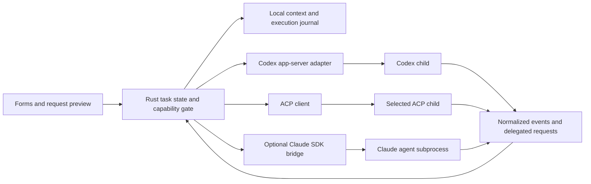

# Agent compatibility and handoff contract

## Status and scope

The binary implements native ChatGPT/OpenAI/Anthropic/Gemini/compatible HTTP connections, the durable local workbench, Codex Plan/controlled Implement, an optional official Claude SDK bridge, ACP1 for OpenCode/Gemini/Devin, and version-1 handoff. **Implemented transport support is not authenticated interoperability acceptance.** Per-service live evidence is recorded in the checkpoint; missing credentials do not become a blanket model-browsing or custom-selection blocker. Existing A04/A06/full A07 agent-conformance gates remain separate. Binding rules live in [DESIGN_RULES.md](DESIGN_RULES.md).

### v0.1.20 project and file-operation contract (release qualification pending)

The canonical launch folder owns tasks, context paths, exclusions, provider cwd and mediated file operations; an enclosing Git repository is optional evidence, not a larger project grant. Plain folders retain filesystem browsing without invented Git verification. Changing tasks does not change projects; launch from another folder to select another project.

Ordinary coding is offered on every route, with exact file consent and shared writer ownership. Native/Codex tools and ACP client filesystem callbacks are mediated; SDK native tools and ACP agent-owned execution retain explicitly reviewed external-policy boundaries. Client callbacks do not sandbox provider-owned tools. Independent managed Review remains unavailable for ACP.

Complete SDK bridge **9** adds one host-owned read-only filtered discovery tool through the SDK's supported in-process tool interface. External MCP servers remain disabled, native subtree source guards remain mandatory, and skipped protected entries do not block safe host discovery. Known provider failure is distinct from reported success and unknown effects.

File output uses a stable filename/status and distinct code surface with an actual-arrival writing edge. Received whole proposals are never animated into fabricated token streams. Paused output/drafts survive generation and approval. Structured external file observations are provider reports; only successful mediated effects establish Applied. Deterministic local protocol/filesystem proof does not establish authenticated provider conformance.

The local v0.1.20 candidate passed all three ACP routes at both sizes/languages: 24 real PTY create/edit/deny journeys, durable writer leases, neutral automatic review, exact one-shot decisions and actual filesystem effects. SDK bridge9 passed 44 policy/real production-IPC cases using the installed SDK, without account/model calls. Native protocol fixtures passed 176 groups; bilingual live-code, file-operation and scroll regressions passed. These are local mediated-operation proofs, not authenticated agent-owned-tool sandbox or all-provider conformance claims.

### v0.1.19 review presentation boundary

Typed current-owner file permissions automatically open at safe home surfaces, initially unengaged; Enter activates the rendered exact-scope summary, then existing one-shot a/y or explicit n applies. Auto-presentation, typing, paste and repeat/modified keys never grant or answer; Esc defers the exact identity. Background owners, generic permissions/questions and existing sheets retain their ownership. File code uses a localized structural file label/gutter, and one-time form-change notifications never cover pending consent/live generated code or change provider capability enforcement. Schema **16** and complete SDK bridge **8** are unchanged; this presentation change adds no authenticated provider acceptance.

Published v0.1.19 passed exact-source Check/all five native packages and immutable promotion. Its downloaded host passed sixteen bilingual/protocol/size staged-file journeys, actual automatic neutral reviews, exact file effects and future caret, all eight automatic forms and one-time manual/return notifications, native protocol 176 groups/ten variants and cooperation 24. Installation passed 23 groups/all 34 terminal scenarios, and genuine public Schema15→16 preservation/refusal/resume passed six cases. These are credential-free transport/UI/filesystem observations; no new authenticated provider conformance is claimed.

### v0.1.18 live file generation boundary

Display-only file previews use the existing owned chronological transcript, not a separate executor, grant or journal. Native Responses/Chat/Messages deliver genuine argument deltas; decoded cumulative paths/code are bounded and privacy-filtered before excerpting. Native Gemini and Codex expose received whole proposals, not fabricated token streaming. SDK bridge revision **8** forwards actual correlated tool-argument fragments through a distinct bounded display path while the original full-input mandatory hooks and exact consent retain write authority. SDK reported results remain provider-reported/unverified; only actual mediated native/Codex success receipts establish applied files.

Generating, received, waiting approval, applied, denied/refused, interrupted, reported and unknown states are distinct. File previews never become copied decisions, canonical assistant text or retained source evidence. Schema 16 is unchanged. Replace the complete bridge/policy/dependency files together; no authenticated all-provider conformance is implied.

Published v0.1.18 passed same-source Check/all-five-native qualification and immutable promotion. Bridge 8 passed **39 policy/production-IPC cases** without account login or model calls. The actual downloaded host passed sixteen bilingual/protocol/size staged-file journeys/64 groups, literal approved writes, no-effect partial/cancel boundaries, private-ID/credential filtering, paused output and exact future draft/caret; ordinary file, evolution, scrolling, native protocol and multi-owner regressions also passed. These remain deterministic transport/UI/filesystem checks, not new authenticated SDK or all-provider conformance.

### v0.1.17 automatic roles and coding boundary

v0.1.17 retains **SDK bridge revision 7** with protocol-1 IPC and complete bridge/policy/dependency files. Schema 16 stores each partner's automatic/manual form mode. Automatic role selection occurs only at an explicit ordinary Request send, before frozen ownership; it never changes the provider/model, restores a form pairing, grants a mutation or executes a command. Read-only Native/Codex roles expose only bounded read/list tools under a nonwriting lease; Implement retains four tools and exact once-only file consent. Necessary role-context changes start fresh owned sessions while old displayed evidence stays attributed.

Frozen root/protected/excluded SDK read authority applies to every noninspection role; Selected/Workspace write authority still requires per-target exact one-shot consent. Mandatory source-tool hooks remain independent of approval callbacks and remain external observational policy, not OS confinement.

Historical v0.1.15 bridge 6 passed 34 policy/production-IPC cases. Historical bridge 7 passed **37 policy/actual production-IPC cases**; isolated actual inspection reported Node **24.15.0**, SDK **0.3.300**, embedded CLI **2.1.300**, protocol 1 and query availability. These checks made no authenticated model call and do not qualify live-provider interoperability. Current bridge 8 verification and runtime/release evidence are recorded separately in the work checkpoint.

Published v0.1.17 passed exact-source Check/all-five-native qualification and immutable package promotion. Its downloaded host passed all eight automatic forms in English/Korean at 120×36 and 60×18, actual readonly CRLF read/list/nonwriting leases, reviewed creation/edit, explicit Plan refusal and manual/automatic real restarts; native protocol 176 groups/ten variants and cooperation 24 also passed. These are credential-free deterministic protocol/UI/filesystem checks, not authenticated model understanding or all-provider live conformance.

Native Responses completion, Chat usage trailers, Anthropic partial cumulative fields and Gemini metadata retain response/turn boundaries. Codex last-turn/session counters retain thread/turn identity and known resumed baselines. Deduplicate repeated snapshots and merge partial fields without replacing missing values with zero. Session/pipeline counters without a known baseline cannot establish request totals; cache/reasoning subsets are not added twice. Model/tokenizer, completion and billing stay unknown where unreported. ACP gains no fabricated accounting support.

Completed owned SDK resumes retain per-session/task/model pipeline baselines in the existing worker. This follows the locked SDK 0.3.300 declarations: resumed/forked sessions continue transcript-saved `modelUsage` totals, while `/clear` resets them. The bridge exposes neither arbitrary follow-up commands nor fork. Unobserved history, failed/unknown turns, missing counters and decreases do not establish attributable deltas; main-loop and model-pipeline scopes remain separate. This is [published SDK-contract evidence](https://unpkg.com/@anthropic-ai/claude-agent-sdk@0.3.300/sdk.d.ts), not new authenticated SDK qualification. Unsuccessful Responses terminal objects retain their reported counters with incomplete coverage and an unsuccessful outcome.

On **2026-10-21 / macOS arm64**, candidate E exercised exactly three explicitly authorized real read-only **Codex 0.147.0** turns with acknowledged requested model **gpt-5.6-luna**, one new owned thread and two actual resumes in the same TUI. Persisted response counters matched reported events; known prior session baselines produced the same resumed deltas without summing overlapping scopes. Usage-report model/tokenizer remained unknown, not inferred from selection; billing remained provider-owned. Original authentication/config files stayed unchanged and temporary credential copies were removed. External/restarted-session attribution and other providers were not newly qualified. Later candidate F fixed local global-default restoration without changing the accounting adapters. Display language changes Eevee labels only, preserving provider/model IDs, raw scope, original errors and permission payloads.

Historical runtime evidence date: **2026-10-13**, Linux/WSL x86_64 only. Codex **0.152.1** used provider-owned ChatGPT authentication, default **gpt-5.6-sol / low**. Real Plan questions/answers, deny/allow, cancel/resume and controlled existing-file edits were exercised. OpenCode **1.18.0** was observed: its free service rejected the previously inspected 1.17.12 with an explicit newer-release requirement; a successful handshake/session alone is not a model round trip. The latest live conformance outcome is recorded in the checkpoint. Gemini **0.28.0** negotiated ACP1 using historical `--experimental-acp`, but actual `session/new` returned **401** for absent configured credentials. These versions are evidence records, not admission pins or current-release conformance claims.

Additional observed evidence, **2026-10-14 / macOS arm64**: nine real Codex 0.152.1/OpenCode 1.18.0 composed handoff, permission, journal, resume/cancellation and capability cases passed. Two real Codex independent reviews used different non-resumable threads, excluded implementation-only next action/history, identified a seeded subtraction defect and preserved project/Git bytes. Review assembles requirements, fresh raw patch and selected observations; it exposes no managed write tools or Resume. SDK review uses the restricted read-only tool policy but remains unqualified without permitted live credentials. Managed ACP review is refused rather than claiming enforcement the adapter cannot provide. These observations do not establish Windows/Linux provider parity or complete Claude/Gemini conformance.

### Explicit latest-stable setup and updates

Install/update external agents explicitly; discovery, Refresh and previews never install or globally upgrade tools. Native HTTP connections require no installed executable. External-agent admission binds reviewed executable/configuration identity and validates actual protocol/capabilities, not an exact release or stable-only label. Bounded recognizable version output is retained as evidence; arbitrary/credential-bearing output and changed launch identity are rejected. This is not a guarantee that every future protocol works.

| Provider | Explicit latest-stable install/update |
| --- | --- |
| Codex | `npm install -g @openai/codex@latest` |
| OpenCode | `npm install -g opencode-ai@latest` |
| Gemini CLI | `npm install -g @google/gemini-cli@latest` |
| Devin CLI | macOS/Linux/WSL install: `curl -fsSL https://cli.devin.ai/install.sh \| bash`; update: `devin update`. Homebrew: `brew install --cask devin-cli`, then `brew upgrade --cask devin-cli`. Windows installers are linked in the official quickstart. |
| Anthropic Console CLI (`ant`, auth only) | `go install github.com/anthropics/anthropic-cli/cmd/ant@latest`; alternatively `brew install anthropics/tap/ant`, then `brew upgrade anthropics/tap/ant` |
| Claude SDK sidecar | `npm run setup --prefix sidecar` explicitly resolves `@anthropic-ai/claude-agent-sdk@latest`; the resulting lockfile records the installation. |

Registry/document observations on **2026-10-15**: Codex **0.162.1**, OpenCode **1.19.0**, Gemini **0.64.0**, Devin stable **3000.11.92**, and `ant` **1.41.0**. Commands resolve the latest stable release at invocation time rather than retaining those numbers. Local WSL verification installed the first three: Codex passed actual first/follow-up model turns at 120×36 and 60×18; OpenCode and Gemini passed ACP1 initialization without model requests. Latest Claude SDK **0.3.300** / embedded CLI **2.1.300** loaded and passed bridge inspection and 16 policy tests, without authenticated model conformance. Devin/ant updates remain document observations, not newly tested login/model flows. Current Gemini uses **`--acp`**, with no silent old experimental-flag fallback. ACP1 negotiation, once-only permissions, unsupported-callback refusal and Codex policy acknowledgments remain mandatory. ACP `agentInfo.version` is a peer-build identity, not necessarily its CLI package version. [U1][U2][U3][U4][U5][G1]

`/connect` opens connection selection; `/connect <route>` enters named setup directly. Passive discovery never executes a provider. Composer Enter and ordinary `/new`/`/resume` send only committed, locally prepared Requests. `/session-new` and `/session-resume` open advanced exact-payload review. Commands/writes, write-enabled sessions, project runtimes, helpers and unmanaged connections retain effect reviews; model/effort/metadata setup sends no task content. Missing setup never replays the old Request. Pasted text/repeats never grant permission; `/sessions` never grants resume ownership.

Native Codex and Codex CLI are explicit searchable routes. Native HTTPS discovers account models and supports scoped Implement file creation/replacement; the CLI retains app-server questions, controlled writes and owned sessions. Their credentials/audiences are not interchangeable. Exact custom IDs remain usable despite stale metadata, failed refreshes retain old rows/errors, and requested/observed model identity stays distinct.

Masked native setup supports session credentials or explicitly saved owner-private plaintext under `~/.eevee-connections/<route>.json` (`USERPROFILE` on Windows), separately from task/preference storage. No encryption/keychain claim is made. Source precedence is session → saved app profile → existing environment/provider source. Save & choose model selects that route and metadata; Ctrl+S saves only locally. Forget app connection neutrally reviews exact own source deletion, never remote revocation or provider-store/task/journal cleanup. Unsafe ownership, ACL, symlink/reparse and project paths refuse.

Native ChatGPT accepts an explicit app token/account, `CODEX_ACCESS_TOKEN`/`CODEX_ACCOUNT_ID`, or an existing disclosed readable provider-owned `CODEX_HOME/auth.json`. Browser/device setup delegates to the existing reviewed official CLI; explicit Load CLI token imports into a masked draft before Save. Official stores are never rewritten. Keychain-only, missing and expired tokens are prerequisites, not fabricated connectivity; automatic renewal is unsupported. Native Anthropic accepts API keys, never subscription OAuth. Configured/default effort remains tied to its model.

Native HTTP refuses redirects/retries, binds endpoint/model/credential identity and preserves immutable payload consent. Coding exposes bounded project list/read, full write and observed-hash unique-match edit tools, with model-proposed targets or optional exact write restrictions. Explicit Plan/Review and metadata stay non-writing; ordinary implicit Eevee requests offer coding on supported routes. Every Implement owns the shared writer lease. Responses/native Codex, Chat Completions, Messages and Gemini retain their own call/result envelopes and request-local signed metadata across eight HTTP rounds/sixteen calls. Whole batches validate before mutation; safe semantic refusal returns correlated zero-effect errors for correction. Truncated/malformed/replayed identities never execute. Genuine optional usage retains explicitly local HTTP-round namespaces, not invented provider response IDs.

Canonical history remains bounded, process-local completed public user/assistant pairs scoped to task/partner/connection/operation, separate from tool transcripts and journals. Fresh Review excludes it; no private reasoning, signed metadata or interrupted output is promoted. Scope drift refuses until `/chat-new`; no silent truncation/account fallback/resend. Project reads require admitted explicit tool calls, not automatic uploads. No native shell/hooks/MCP or opaque provider resume is enabled. Settled client writes can release local ownership while remote completion/billing remains unknown; ambiguous filesystem effects remain blocking across provider changes.

The **0.152.1 experimental** generated schema was the historical implementation reference, not a requirement to install that release. Generate the installed executable's schema explicitly with `codex app-server generate-json-schema --experimental --out DIR`; runtime policy acknowledgments remain mandatory. Historical SHA-256:

| Generated bundle | SHA-256 |
| --- | --- |
| `codex_app_server_protocol.schemas.json` | `65ce2db95109ebedc995d0ff74cc8bcefaa69fc3270f65b4fc69c1877c651f4e` |
| `codex_app_server_protocol.v2.schemas.json` | `f9e3ca7e56300b4e5a5686419940ef77bbdc42846760d6a9cd53a21f20dc9ebd` |

Codex questions use experimental `item/tool/requestUserInput`; Plan command approvals retain exact offered once-only responses. Implement advertises shared bounded list/read/write/edit tools. Hash-bound exact edits require previously observed source, one literal match and full replacement review; eight write targets up to 64 KiB retain optional restrictions, exact Create/Replace/content/parent consent, no-overwrite publication and stale/protected/link/reparse refusal. Read observations do not consume write-target quota. Native file-change/command escalation, persistent amendments, unsupported requests, replay and retries remain refused. Provider-controlled effects outside these tools remain external, not universally isolated. Private reasoning/raw stderr/auth are not displayed.

Controlled Codex Implement prepares a fresh thread for each ordinary Request; a planning or resumed thread cannot inherit its dynamic tool. Explicit resumed controlled implementation remains refused. This differs from Plan sessions and native process-local public conversation history.

Provider sessions/viewer items remain Eevee-session-local and provider-scoped. Explicit resume uses an observed same-task/provider/operation session. User-selected complete messages/plans become reviewed, unverified Next actions; provider-native tools have separate quota-backed, append-only schema-5 journals with origin/coverage and truthful complete/partial state. Storage retry never reruns a provider. Deletion/purge previews include these rows; provider-owned history is not erased by local deletion.

The Rust core stays native; only the optional Claude bridge needs Node. No webview, daemon-per-form, automatic swarm, external MCP server or plugin framework is introduced. The SDK's single in-process host discovery tool is a bounded read-only implementation detail.

## Separate the identities

| Identity | Meaning | Example |
| --- | --- | --- |
| Form | Eevee workflow, expected artifact, and requested operation scope | Glaceon: independent requirement/diff review |
| Agent profile | Executable/SDK, adapter, observed release/schema, working directory, configuration, and control capabilities | Codex over an identity-bound, protocol-qualified app-server child |
| Model / provider mode | Agent-advertised model/effort/tool mode; not another Eevee evolution | An OpenCode mode remains an OpenCode agent setting |
| Task | Eevee-owned goal, criteria, approved context, artifacts, and next action | The same task can receive a reviewed cross-agent handoff |
| Provider session | Opaque conversation identity owned by one integration | A Codex thread ID is not a Claude session ID or a filesystem snapshot |

Pick one default execution agent for a task. A role-specific override is optional and capability-checked; never spawn nine agents because nine forms exist. Selection is local. Connect is explicit and does not submit a prompt. Preview is not Run. An unsent draft is never an agent-side queued message.

## Implemented interfaces and qualification boundaries

| Profile | Selected interface | Interactive target | Boundary / admission requirement |
| --- | --- | --- | --- |
| Codex native / ChatGPT | Native Codex HTTP catalogue + Responses SSE | Account models, exact selected model, streamed text and cancellation | Explicit app/session/environment credential; fixed official endpoint. Inference needs no CLI/tools; browser/device sign-in delegates to the official installed CLI. No opaque provider resume or automatic token refresh. |
| OpenAI API | Native Models + Responses SSE | Configured/custom models and streamed text | API key; endpoint is separately configured/reviewed. Not ChatGPT subscription billing. |
| Anthropic API | Native Models + Messages SSE | Paginated discovery and streamed text | API key only; optional custom API endpoint. Not claude.ai OAuth or Agent SDK. |
| Google Gemini API | Native Models + streamed generateContent | Paginated discovery and streamed text | Google/Gemini API key; no CLI or Cloud Code Assist credential assumption. |
| Compatible / local API | Native Models + Chat Completions or Responses SSE | Configured/custom model IDs, endpoint discovery and streamed text | Explicit in-app/environment key or explicit keyless service; HTTP only for loopback. Protocol is selected, never guessed from provider/model name. |
| Codex | Rust-owned private stdio app-server; observed version, no exact-release gate | Plan questions/command permissions, cancel/resume; Implement dynamic workspace/selected create/replace proposals | Eight files ≤64 KiB each, exact complete content/parent consent and native POSIX/Windows no-overwrite enforcement. Dirty bytes, links, stale/protected targets and aliases are checked; no fork/native workspace-write. Native OS execution evidence remains separate. |
| Claude Agent | Official SDK, embedded CLI, Node ≥24, protocol-1 IPC / complete bridge revision 9 | `query`, host-owned filtered discovery, `canUseTool`, mandatory source/write PreToolUse, questions, elicitation, interrupt and explicit resume | Frozen project read/privacy boundaries; workspace/selected writes retain 256 files ≤256 KiB, exact input consent and verified own-parent advancement. Failed changed effects remain unknown. External observational policy, not atomic confinement; no external MCP servers. Fixtures/inspection are not live authentication conformance. [H1–H5] |
| OpenCode | Shared ACP1 client; `acp --pure` | Prompt/update, project read/write callbacks, exact once-only permissions, cancel, negotiated load/list | Implementation requires explicit external-policy review. Client filesystem writes use exact shared consent; provider-owned tools/config/MCP remain external. Terminal/question extensions refused; managed Review unavailable. `--pure` suppresses external plugins, not all config effects. [P1][P2][O1] |
| Gemini CLI | Same ACP1 client; current stable `--acp` | Negotiated prompt/update/permission/cancel/load; absent `session/list` explicitly refused | Historical 0.28.0 experimental-mode init/capability mismatch exercised; authenticated prompt/permission/cancel blocked by session/new 401. Current `--acp` route is documented, not live-model qualified here. No inherited OpenCode extensions or free-product claim. [G1] |
| Devin CLI | Same ACP1 client; `acp` (local, not `--cloud`) | Negotiated prompt/update/permission/cancel/load/list and project filesystem callbacks | Historical 3000.11.3 isolated browser-login/init evidence is not current authenticated acceptance. Shared mediated-client/external-agent implementation boundary; managed Review remains refused. Peer build metadata is separate from bound CLI identity. [D1] |
| Other CLI / incompatible version | Reviewed JSON/Markdown task handoff; explicitly external/manual execution | Portable task context, manually imported results labelled unverified | No ANSI scraping, automatic keystrokes, invented approvals, generic `--json` assumption, or claim of in-app cancellation/resume |

MCP supplies tools/resources/prompts to a host; it is not interchangeable with ACP or an agent-session controller. Preserve each agent's MCP ownership/configuration boundary rather than automatically copying connectors between agents. Existing third-party ACP bridges have their own dependencies, releases, authentication terms, and limits; their existence does not establish native support. [M1]

## Runtime ownership and capability contract

Use concrete adapters behind the smallest common request/event boundary, not a universal agent framework. Retain provider-specific details for inspection instead of flattening away semantics.

### Profile snapshot and preflight

- Snapshot adapter/schema revision, executable/SDK identity and version, literal argv, canonical cwd, model/mode, configuration-source identifiers, effective policy, credential-source label, and a monotonically increasing connection/run generation. Fingerprints must not contain credentials or secret values.
- Resolve a known or explicitly user-chosen executable. A project-supplied wrapper, hook, plugin, MCP server, or command is executable configuration, not passive context. Explain trust/config-loading effects **before** launch; even a version probe executes a program. Never automatically run a repository-provided probe.
- Keep installed, compatible, authentication-required, ready, and disconnected states distinct. Missing metrics/capabilities are unknown or unsupported, never zero/yes. Cache nonsecret discovery; no model request for a picker, redraw, or help screen.
- Capability records cover text/image/excerpt input, streamed output, tool observation, mediated command/file/permission requests, human questions/elicitation, turn interruption, resume/fork, usage scope, and filesystem/network enforcement. Record evidence source, native OS/architecture, and executable version. Different operations in one profile can have different control levels; working on one OS does not establish support on another.
- Show **Eevee-mediated**, **agent-policy-controlled**, or **observed/external** per action. A permission callback, a cwd, a worktree, and a prompt saying read-only are not OS isolation. If a required restriction cannot be enforced, disable the controlled action with a reason; offer a separately labelled external workflow only after explicit choice.
- Credentials remain agent/provider-owned. Use supported status/login interfaces; never read/copy OAuth stores or silently switch the billing source. Authentication handoff suspends/restores terminal ownership and requires an explicit action. Provider terms and auth eligibility are launch/distribution gates, not properties of a transport.
- Implemented official connection methods: Codex browser `login`, `login --device-auth`, and `login status`; OpenCode `auth login --pure` and `auth list`; Gemini's native CLI authentication chooser (`/auth` when already connected) for Google OAuth/browser/manual-code, API key or Vertex. Historical Gemini 0.28.0 ACP `authenticate` emitted terminal escapes, an OAuth URL and a raw authorization-code prompt on its JSON stdout; Eevee therefore uses only the separately reviewed native handoff, not structured ACP authentication. No code interception, injected confirmation, token-store copying or mixed-protocol parser is substituted. Available methods and account eligibility remain distinct. [O2][G2]
- Devin uses dedicated native `auth login` for browser OAuth, explicitly selected `auth login --force-manual-token-flow` for manual token paste, and `auth status`. Manual token paste is not device OAuth; Eevee never collects the token or switches routes automatically. Login/status exit zero remains unknown: the observed 3000.11.3 logged-out status command also exited zero. Credentials are excluded from discovery/configuration identity scanning. [D1]
- Codex method selection defaults to callback-free device authorization on detected WSL/SSH; browser OAuth remains explicitly selectable. Detection changes only the initial selection, never an approved invocation. Device authorization requires the provider's personal/workspace setting and does not fall back to browser on failure. Keep browser login running through its callback; WSL host browsers and remote clients may need loopback forwarding. See [localhost refusal recovery and local-listener regression coverage](TROUBLESHOOTING.md#2026-10-14-browser-oauth-returns-to-localhost-with-connection-refused). Native Windows/macOS OAuth completion and the specific user's browser-forwarding configuration remain unverified.
- Gemini's preview explicitly authorizes **external native CLI handoff**, not an auth-only sandbox: startup may initialize provider configuration/services, and the native UI can continue into chat or execute user-entered work. Eevee starts it outside the task project and sends no task/model prompt. The user handles native authentication and exits to return; a subsequent Eevee request requires fresh consent.
- Native auth uses a private empty outside-project cwd, refuses changed/inserted configuration before launch, and removes it only if still empty. User/provider-created files are not recursively erased. Gemini native login refuses `CI=true` or `GITHUB_ACTIONS=true` with an actionable reason because the official CLI otherwise selects headless mode; normal interactive use must not inherit those flags.
- Auth review requires 60×18, committed idle task/context/journal state and a compact exact executable/argv/cwd/effects summary. It starts on Back; Connect is explicit and full technical Details are separately available. Approval expires after five minutes; login has a ten-minute deadline and status fifteen seconds. Generation-owned preparation cannot revive a cancelled review; dispatch repeats identity/version checks. The normal version probe remains separately available at 60×18.
- Provider-native auth may open browsers, bind callback listeners, contact identity services, and write/replace credentials or auth-method settings. Provider configuration effects need consent. An external CLI handoff does not itself import credentials; native readable-token import is a separate explicit masked-setup action, not keychain extraction or automatic account replacement. Native output is transient and not appended to task logs, but can persist in terminal scrollback. Owned terminal/input modes and child process ownership are restored on return. POSIX foreground process groups and suspended-before-Job Windows admission are implemented; Windows authentication is cross-checked, not runtime-qualified.
- Codex's exact official ChatGPT login-status line plus matching exit code can establish authenticated/not-authenticated state; separate startup WARNING lines do not invalidate it. Conflicting/unknown output remains unknown. API-key status text is not retained. OpenCode exit/inventory and Gemini native exit alone stay unknown; neither proves model/product eligibility. Login success, failure, or cancellation invalidates cached model sessions and prior Run consent, never replays a task, and cannot erase unresolved prior outcomes.
- Do not modify global agent configuration to make an integration pass. Disclose and obtain explicit consent for **provider-owned persistent effects**, including Codex 0.147.0 workspace-write thread startup marking a project trusted. If those effects cannot be bounded/previewed, do not launch that controlled workflow. Read-only discovery is not permission for a mutating session. [C1]

### Requests, events, and backpressure

- Eevee owns local task/run IDs, generation, artifact references, and UI state. Preserve provider session/turn/item/request IDs when available. Never derive durable identity from display text or assume IDs are global across profiles.
- Admission revalidates the previewed task/context revision, resolved source identities (including symlink/junction replacements), profile/config, and grants. Changed input invalidates the preview; never silently substitute payload bytes or widen selected context. This governs Eevee-sent content, not independent provider-owned reads.
- Model/effort are immutable request fields; only acknowledged returned settings are observed. Scope changes invalidate pending requests and incompatible owned sessions retain Keep current / New session / Back. Schema 10 persists nonsecret per-route selection and last-used provider/method only; catalogue snapshots, sessions, credentials and grants remain session-local. Explicit `EV_PROVIDER` wins startup route; await preference hydration/error recovery before connecting. Save failure retains current choices/draft, exposes retry and delays safe exit until commit.
- Catalogue refresh is metadata, not a model turn. Qualified native/installed read-only routes need no second review; project-supplied runtimes, helper chains and unmanaged effects still need their real connection consent. Codex retains configured defaults and complete bounded pages with source/version provenance, Claude withholds prompt input during `supportedModels()`, and ACP uses its disclosed temporary session/configuration lifecycle. No metadata operation loads history, owns a resume grant or writes a model-turn journal; failed refresh preserves the previous cache and error.
- Discovery is not an execution allowlist, including on SDK/ACP routes. Codex and ACP require exact model/setting acknowledgments rather than catalogue membership. ACP still requires official model/thought-level controls and correlated setter success; changing models may replace reasoning controls. Claude uses `setModel()` plus local `getContextUsage({detail:'summary'})` to acknowledge exact IDs or advertised resolved aliases before prompt release. Missing/failed SDK discovery does not block an otherwise acknowledged explicit model; inspection failures remain visible and do not replace cached lists. SDK effort choices are advertised request values passed through official Options, not a claim of observed applied effort; organization caps/downgrades may apply. Authentication and tool-policy acknowledgments remain mandatory independently of discovery.
- Normalize connection state, text deltas/snapshots, tool starts/updates/results, diffs/artifact references, permission requests, user questions, usage, terminal outcomes, and errors. Keep origin, receipt order, raw-type metadata, and live-versus-replay provenance. Render no private reasoning stream by default; do not request or export hidden chain-of-thought.
- A correlated request is not a progress notification. Exactly one valid response may resolve a live request; cancellation, provider resolution, or a changed run generation invalidates the UI action. Preserve provider option IDs and grant semantics. Secret answers are masked and not written to Eevee history/logs; disclose that provider storage is separate.
- Reconcile deltas and final snapshots by real message/item identity; never count both as independent text/usage. If replay has no stable event identity, replace the replayed view from its source boundary rather than deduplicating equal text. Repeated identical text can be legitimate output.
- Allow one foreground mutable run per task/repository. Drafting and browsing remain local; additional submissions require the current run to finish or cancel. No autonomous child-agent fan-out; exclude delegation tools when the provider can expose them independently of approval callbacks.
- Drain stdout protocol and stderr diagnostics independently. Bound frame sizes, queues, retained text, and spool storage. Coalesce only repaint deltas; never drop permission, error, terminal-state, or durable evidence events. Persist large artifacts by reference rather than copying complete histories through each UI frame.
- Cancellation has three stages: requested, provider-confirmed terminal outcome, and process teardown if needed. Do not mark success/cancelled from an interrupt acknowledgment or EOF alone. Forced termination/disconnect yields outcome unknown until reconciled; it is not rollback. Diagnose remaining children before claiming cleanup.
- Reconnection never automatically resubmits a potentially mutating turn. Inspect provider state when supported, reconcile working-tree changes, then let the user resume or start a new request. A new connection cannot revive an old approval.
- Record token/cost values with provider/model, unit, scope, cumulative/per-turn semantics, and accounting boundary. Preserve unknown values. Never sum resumed cumulative totals or equate rate limits with dollars; no cross-provider grand total for incompatible scopes.

## Provider-specific constraints

### Codex

Use release-generated JSON Schema for the installed supported executable. Its app-server framing is JSON-RPC-style JSONL **without** the `jsonrpc` member; do not send it through an ACP parser. `initialize` then `initialized` is required. `clientInfo.version` identifies Eevee, not a negotiated Codex protocol version. Experimental APIs require explicit opt-in and live field/policy qualification; recognizing a CLI version alone is not compatibility evidence. [C1]

- Core methods: `thread/start`, `thread/resume`, `thread/fork`, `turn/start`, `turn/interrupt`. Wait for matching `turn/completed` with `interrupted` after cancellation; the immediate interrupt response is not completion.
- Approvals: `item/commandExecution/requestApproval`, `item/fileChange/requestApproval`, and permission-subset requests. Reply to the original request ID. Distinguish accept once, session grants, persisted policy amendments, decline, and cancel; consume `serverRequest/resolved` to invalidate stale panels.
- Questions: `item/tool/requestUserInput` is experimental in the reviewed release. MCP elicitation is a separate request type. Pin field semantics instead of mixing older timeout examples with newer schemas.
- Native tool events are observations unless a delegated approval actually occurs. Already-permitted tools can run without an Eevee prompt. `process/spawn` and `thread/shellCommand` are documented outside the Codex sandbox; do not use them as substitutes for sandboxed turn execution.
- Read effective config/provenance and managed requirements through supported interfaces. Explicitly inspect approval reviewer ownership: automatic review is not human approval and can consume extra model usage. Cwd/instruction sources and provider-added context remain visible as known/unknown.
- `codex exec --json` and its TypeScript SDK wrapper are noninteractive batch surfaces, not fallback implementations of the interactive contract. In 0.147.0, interrupted exec may exit without a terminal JSON turn event; exec has no fork subcommand. Do not silently downgrade.
- Let Codex own local authentication and refresh. Current official auth documentation distinguishes local/open-source use from commercial/hosted entitlement; confirm terms before distribution. [C2]

### Claude Agent SDK

Keep the Rust core native. Choose an optional TypeScript sidecar because the documented SDK supplies the richer interactive lifecycle without reimplementing the whole subprocess transport. Rust-native CLI/hooks/MCP-permission integrations are possible but are not equivalent drop-in approval hosts; a sidecar is a design choice, not an Anthropic requirement. Do not depend on removed experimental SDK session APIs. [H1][H2]

- Version the minimal local IPC: start/resume a query, submit one turn, answer a correlated permission/question, interrupt, receive events/results, and close. Use the documented `query()` API with streaming input. Spawn only on demand; no mandatory Node process for local work or another provider.
- Use explicit permission mode, tool exposure, setting sources, and MCP controls. `allowedTools` preapproves tools; it is not an exclusive tool allowlist. `canUseTool` only handles calls requiring approval; mandatory policy cannot live solely in that callback. SDK defaults and managed/global configuration must be checked against the inspected installed runtime. [H3]
- Honour callback abort/request/tool identifiers, default-to-no and suppress-always-allow metadata when supplied. Never persist a suggested permission update as a one-time grant. Treat `AskUserQuestion` answers and MCP elicitation as separate typed interactions. Unsupported question schemas cannot receive fabricated answers.
- `interrupt()` stops the current turn but does not necessarily clear queued input. Eevee submits no follow-up while a turn runs; verify any provider queue/interrupt receipt before claiming a full stop. Consume a terminal result; `message_stop` is not turn completion. `close()`/process kill is teardown, not rollback. [H4]
- Resume/fork by explicit session ID and reapply policy. Conversation fork is not a filesystem branch. Provider transcripts live outside Eevee's database and may be unavailable after local deletion.
- Respect current SDK terms/branding: label the profile **Claude Agent**; use permitted API/provider authentication. Do not offer claude.ai login/subscription limits without prior approval, copy login stores, or assume an installed personal Claude Code login authorizes the product integration. [H1]
- SDK cost totals may be cumulative, restored across resume, and broader than main-loop token usage. Display their scopes, avoid double counting, and label estimates rather than invoices. [H5]

The optional bridge is `sidecar/main.ts`. Explicit `npm run setup --prefix sidecar` resolves latest stable SDK with scripts disabled and optional platform dependencies included; `npm ci` reproduces the lock snapshot. Set absolute `EEVEE_CLAUDE_SIDECAR` (default `~/.local/share/eevee/claude-agent/main.ts`) and optionally `EEVEE_CLAUDE_NODE`. `node sidecar/main.ts --inspect` imports the SDK without a model request. Protocol 1 requires **complete bridge revision 9**, typed frozen read/write authority, host-owned filtered discovery and independent mandatory source-tool checks. Update all bridge source/policy/dependency files; older bridges refuse before prompts. Exact model, requested-only effort, correlated submission and scoped usage remain. Queue acceptance, metadata or mismatched/replayed acknowledgments never establish dispatch; receipts are not completion/billing/live conformance.

Admission requires exactly one permitted `ANTHROPIC_API_KEY`, Anthropic Console OAuth profile, or explicit `CLAUDE_CODE_USE_BEDROCK`/`CLAUDE_CODE_USE_VERTEX` route. The Console profile is created by the official `ant` CLI (`auth login`/`auth status --profile <name>`, default profile `eevee` or `ANTHROPIC_PROFILE`). It is API-billed Console OAuth through `ANTHROPIC_CONFIG_DIR`/`ANTHROPIC_PROFILE`, not claude.ai subscription login. Eevee checks only that `configs/<name>.json` and `credentials/<name>.json` exist, never their contents. The sidecar binds the explicit directory/name before isolating HOME, gives every other route an empty profile directory, and requires `accountInfo()` to report first-party with no API-key/token source before releasing the prompt (an API key, subscription or missing profile reports one). claude.ai subscription OAuth, arbitrary preload/base-URL fallback, and copied login stores are refused. Bedrock supports explicit keys, bearer tokens (`AWS_BEARER_TOKEN_BEDROCK`), and web identity (`AWS_WEB_IDENTITY_TOKEN_FILE` plus `AWS_ROLE_ARN`). Selected Bedrock/Vertex additionally permits `EEVEE_CLAUDE_CLOUD_AUTH=provider-chain`: an explicit opt-in to AWS SSO/profile/workload or Google ADC/workload chains, not a silent credential fallback. These routes may read/refresh caches, execute `credential_process` or external credential helpers, and contact identity/metadata services; the request preview discloses those external-policy effects. Only the selected cloud chain retains inherited HOME; `CLAUDE_CONFIG_DIR` stays isolated under the Eevee data directory's `claude-agent-state`. The inspected SDK's `accountInfo().apiProvider` must match the selected backend before releasing the prompt. [H6]

Filesystem setting sources are empty; the sole MCP configuration is host-owned read-only project discovery. External servers, shell/delegation/web/worktree tools and executable SDK configuration remain disabled. Native Read/Glob/Grep keep mandatory root/privacy/subtree checks; safe bounded discovery is mediated separately rather than bypassing those checks. Selected writes serialize until the actual terminal tool result and revalidate identity after consent. Overlapping permissions are denied rather than replacing visible approval. Interrupt acknowledgment is not terminal cancellation: authoritative success remains completed, known reported failure stays distinct, and ambiguous termination remains unknown.

Implementation offers selected-path Write/Edit policy hooks and explicit once-only permission, **not atomic filesystem confinement**; consent must accept external policy. One query has no follow-up queue, a 16-turn / estimated USD 5 bound, and latest cumulative pipeline usage snapshots (never summed across resume or described as invoices). Fork is not exposed. Live question/deny/allow/interrupt/resume acceptance remains blocked without permitted credentials.

### ACP peers: OpenCode, Gemini and Devin

Negotiate the supported protocol version and client/agent capabilities through `initialize`; omitted optional capabilities are unsupported. Implement the supported released **v1** contract first, not draft/v2 examples mixed into a v1 parser. `session/new`, `session/prompt`, `session/update`, and `session/cancel` are baseline; load/fork, images, forms, filesystem/terminal callbacks, and extension methods need their actual capability/extension contract. [P1][P2]

- Advertise only callbacks Eevee implements. Client filesystem/terminal requests go through Eevee's actual policy gate; agent-owned execution does not become client-controlled by sharing the same protocol.
- Agents **may** request permission. Preserve `session/request_permission` option IDs and kinds; `allow_always` does not imply Eevee-task scope. Resolve pending permissions as cancelled when required by cancellation. A cancel notification does not itself prove the prompt ended. [P2]
- Separate live updates from load replay; updates can occur outside an active prompt. Feature-specific failures disable the relevant action, not all local navigation.
- OpenCode uses newline-delimited stdio JSON-RPC, stdout for protocol, stderr for logs, and a private server owned by that ACP child. Do not assume it joins a shared daemon. Session load/resume/fork require the original cwd. Cwd configuration can load instructions, hooks/plugins, MCP servers, models, and commands; additional directories/configuration can affect later sessions. [O1]
- OpenCode may resolve a `file://` resource link into the **whole file**. For a promised excerpt-only outgoing request, submit reviewed text/embedded content supported by the peer instead of a link that silently widens context. Agent-owned subsequent reads still need a separately disclosed/enforced policy.
- Provider-specific form questions, mode/model configuration, usage, compaction, and session operations remain capabilities/extensions, not assumed ACP invariants. No fake answers for unsupported elicitation.
- Gemini's current guide documents `gemini --acp`; Eevee launches that literal reviewed argv and requires an ACP1 handshake before any session/prompt. Experimental-only older CLIs must be updated, not retried with undisclosed arguments. Its current documentation also notes account/product migration affecting unpaid/Google One access. Record the actual auth route and eligibility; do not silently substitute another product. [G1]

Observed capability difference: OpenCode negotiates `sessionCapabilities.list`; Gemini 0.28.0 omits it. `/sessions` invokes only the negotiated method; an unsupported peer explains the missing capability and receives no `session/list`, `session/new`, `session/load` or `session/prompt`. Metadata is filtered to the exact reviewed cwd, bounded to 256 received / 64 displayed entries, and cannot authorize adopting a foreign session.

Client filesystem callbacks are advertised only for actual supported noninspection operations: bounded reads and Implement-only exact reviewed writes use the current project and shared policy/executor. Terminal callbacks remain unavailable. Agent-owned tools remain external policy, not confined by those callbacks. Only literal prompt text is sent, never whole-file links. Journals finalize correlated provider snapshots once; structured file observations distinguish received/reported/failed from actual mediated application. Transport loss retains partial results and honest unknown effects. No standardized negotiated token/cost coverage is inferred.

## Same-agent resume versus cross-agent handoff

**Resume** means reopening the explicit provider session under a compatible adapter/release/cwd and reviewed current policy. Validate its stored identity, actual availability, context/accounting boundary, and external changes before a new turn. A changed policy/configuration requires a new preview, not inherited approval. Never resume by guessing the latest session in a directory.

**Handoff** means a new provider session with a reviewed, versioned Eevee context bundle. It does not transfer hidden state, permissions, or a complete provider conversation.

Implemented **schema 1** contains `schema_version`, `task` (ID, revision, goal, criteria, next action), approved `facts`, selected `sources` (excerpt ID, root-relative path, inclusive line range, SHA-256, bytes), `decisions`, and `unresolved`. JSON and Markdown share the exact schema. Unknown fields/versions and unsafe references are rejected. Generated local provider-session suffixes are removed from portable next-action facts and every adapter's outbound task metadata. No session/grant/private reasoning/credential/evidence-authority fields are accepted; imported text remains unverified. Dispatch revalidates current committed task revision/facts and exact selected source identities/bytes; stale foreign bindings are not silently rebound.

Switching flow: finish/cancel the live run -> inspect unsaved work and source changes -> choose compatible agent -> preview outgoing handoff and new control/config/auth boundaries -> explicitly start a fresh session. Preserve the old conversation reference locally. Glaceon starts from requirements/current diff/evidence, not the implementation agent's entire private history, even when using the same execution agent.

Manual Markdown/JSON export serves unsupported CLIs. Imported notes/results are external assertions until independently verified; a claimed exit code in a document is not a verified Jolteon run. Reject unknown newer schemas and unsafe source references rather than executing content. No auto-launch on import.

## Shared conformance gate

Run these scenarios on a disposable workspace for **each advertised profile/version/native OS combination**. Model requests require real permitted credentials; mocks/schema fixtures cannot establish runtime compatibility. Store evidence in the checkpoint, not product badges inferred from docs. Missing optional providers leave their interoperability gates pending without blocking independently verified local-core work; full Q01 acceptance still requires every required gate.

1. **Admission:** real executable/version/init, stdout/stderr separation, missing/incompatible dependency, auth-required state, and project configuration trust preview without an automatic model request.
2. **Context:** preview outgoing exact excerpts/criteria; inspect source freshness, provider-added context disclosure, excluded secrets, and a whole-file-link widening case. Replace a selected file or symlink/junction between Preview and Run and verify admission refuses the stale preview without sending substituted bytes. Prove actual promised confinement through each enabled tool path or keep that capability disabled.
3. **Permission/input:** real deny/no side effect and allow-once/no saved rule; ask/answer a supported question; dismiss/reopen without granting; cancel while pending; reject stale/replayed responses. Unsupported questions fail explicitly.
4. **Streaming/stop/failure:** preserve Unicode ordering and user scroll position under large output; avoid delta/final duplication; interrupt and observe a terminal outcome; terminate unexpectedly and retain partial evidence with unknown outcome. No auto-resubmission or hidden queued work.
5. **Continuity/accounting:** reopen an exact session when supported; distinguish fork from source snapshot; switch agents through a reviewed fresh handoff; preserve dirty user files; verify permission reset, replay reconciliation, and non-double-counted cumulative/partial usage.
6. **Independent peer:** run ACP scenarios against both OpenCode and Gemini, including a capability mismatch. A method working on one peer does not mark it supported on the other.

## Primary sources

- [C1] [Codex 0.147.0 app-server reference](https://github.com/openai/codex/blob/rust-v0.147.0/codex-rs/app-server/README.md), [release exec CLI](https://github.com/openai/codex/blob/rust-v0.147.0/codex-rs/exec/src/cli.rs), [release exec event mapper](https://github.com/openai/codex/blob/rust-v0.147.0/codex-rs/exec/src/event_processor_with_jsonl_output.rs).
- [C2] [Codex app-server authentication](https://learn.chatgpt.com/docs/app-server#auth-endpoints), [sandbox versus approvals](https://learn.chatgpt.com/docs/agent-approvals-security), [configuration layering](https://learn.chatgpt.com/docs/config-file/config-basic).
- [H1] [Claude Agent SDK overview, auth restriction, terms, and branding](https://code.claude.com/docs/en/agent-sdk/overview), [quickstart/authentication](https://code.claude.com/docs/en/agent-sdk/quickstart).
- [H2] [Claude SDK user input](https://code.claude.com/docs/en/agent-sdk/user-input), [TypeScript reference](https://code.claude.com/docs/en/agent-sdk/typescript), [CLI reference](https://code.claude.com/docs/en/cli-reference).
- [H3] [Claude SDK permissions](https://code.claude.com/docs/en/agent-sdk/permissions), [configuration loading](https://code.claude.com/docs/en/agent-sdk/claude-code-features), [sandbox coverage](https://code.claude.com/docs/en/sandboxing#what-runs-outside-the-sandbox).
- [H4] [Claude streaming output](https://code.claude.com/docs/en/agent-sdk/streaming-output), [sessions](https://code.claude.com/docs/en/agent-sdk/sessions), [TypeScript interrupt semantics](https://code.claude.com/docs/en/agent-sdk/typescript#sdkcontrolinterruptresponse).
- [H5] [Claude SDK cost tracking](https://code.claude.com/docs/en/agent-sdk/cost-tracking).
- [P1] [ACP v1 initialization/capabilities](https://agentclientprotocol.com/protocol/v1/initialization).
- [P2] [ACP v1 prompt lifecycle](https://agentclientprotocol.com/protocol/v1/prompt-turn), [tool calls/permissions](https://agentclientprotocol.com/protocol/v1/tool-calls).
- [O1] [OpenCode ACP launch and boundary](https://opencode.ai/docs/acp/), [qualified 1.18.0 package metadata](https://registry.npmjs.org/opencode-ai/1.18.0).
- [G1] [Gemini CLI ACP mode and availability notice](https://geminicli.com/docs/cli/acp-mode/).
- [M1] [MCP architecture and responsibilities](https://modelcontextprotocol.io/docs/learn/architecture).
- [H6] [Claude Code on Amazon Bedrock](https://code.claude.com/docs/en/amazon-bedrock), [Claude Code on Google Vertex AI](https://code.claude.com/docs/en/google-vertex-ai), [pinned SDK 0.3.296 declarations](https://unpkg.com/@anthropic-ai/claude-agent-sdk@0.3.296/sdk.d.ts).
- [O2] [OpenCode provider authentication](https://opencode.ai/docs/providers/).
- [G2] [Gemini CLI authentication methods and account eligibility](https://geminicli.com/docs/get-started/authentication/).
- [D1] [Devin CLI command/auth/ACP reference](https://docs.devin.ai/cli/reference/commands), [official ACP setup](https://docs.devin.ai/cli/acp/zed), [stable release notes](https://docs.devin.ai/cli/changelog/stable), [3000.11.3 official checksum manifest](https://static.devin.ai/cli/3000.11.3/manifest.json).
- [U1] [Codex current stable npm metadata](https://registry.npmjs.org/@openai/codex/latest), [current app-server reference](https://developers.openai.com/codex/app-server).
- [U2] [OpenCode current stable npm metadata](https://registry.npmjs.org/opencode-ai/latest), [official CLI installation/update reference](https://opencode.ai/docs/cli/).
- [U3] [Gemini current stable npm metadata](https://registry.npmjs.org/@google/gemini-cli/latest), [official release channels](https://geminicli.com/docs/releases/).
- [U4] [Devin installation/update quickstart](https://docs.devin.ai/cli), [stable release notes](https://docs.devin.ai/cli/changelog/stable).
- [U5] [Official Anthropic CLI installation](https://github.com/anthropics/anthropic-cli#installation), [1.41.0 stable release](https://github.com/anthropics/anthropic-cli/releases/tag/v1.41.0).
