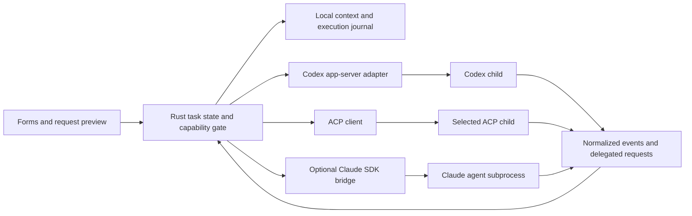

# Agent compatibility and handoff contract

## Status and scope

The binary implements the local durable workbench, source context, owned local execution/evidence, and **A01 agent preflight**. Model adapters and provider interoperability remain unavailable. Binding interaction rules live in [DESIGN_RULES.md](DESIGN_RULES.md); runnable increments and acceptance gates live in [../task.md](../task.md).

Evidence date: **2026-10-13**. Actual Linux/WSL observation: installed `codex-cli 0.152.1`; `codex app-server --help` advertises the experimental server and stdio transport. The real connection drawer independently observed this version after explicit trust. The previous `0.147.0` reference remains documented-only, not a qualified adapter release. Claude/OpenCode/Gemini PATH entries under Windows-mounted Node installations were discovered, not executed or qualified. No agent handshake, authentication, model request, approval, or cross-agent continuation was exercised. The references below establish documented interfaces, not tested interoperability or distribution rights.

Implemented A01: `o` opens passive four-profile discovery; Enter previews executable/configuration trust, PgDn/End reviews, Tab explicitly selects Trust, and Enter authorizes one bounded `--version` probe. Known source identities/nonsecret declarations are inspected without loading provider hooks. Effective policy, authentication validity, selected billing account, and protocol enforcement remain unknown; all model actions are disabled. Probe identity is revalidated, arbitrary output is withheld, and shutdown cancels the owned child. Inherited environment/interpreters/dependencies are disclosed, not claimed isolated. Five real PTY scenarios and eleven workbench regressions passed locally; CI/P02 remains deferred.

Target: one local workbench for user-directed specialist workflows across Codex, Claude Agent SDK, OpenCode, and Gemini CLI. Keep the application/core/UI in Rust. An optional Claude SDK bridge is the only planned additional runtime; no webview, daemon-per-form, automatic swarm, new MCP server, or arbitrary plugin framework is needed.

## Separate the identities

| Identity | Meaning | Example |
| --- | --- | --- |
| Form | Eevee workflow, expected artifact, and requested operation scope | Glaceon: independent requirement/diff review |
| Agent profile | Executable/SDK, adapter, release/schema, working directory, configuration, and control capabilities | Codex over a release-pinned app-server child |
| Model / provider mode | Agent-advertised model/effort/tool mode; not another Eevee evolution | An OpenCode mode remains an OpenCode agent setting |
| Task | Eevee-owned goal, criteria, approved context, artifacts, and next action | The same task can receive a reviewed cross-agent handoff |
| Provider session | Opaque conversation identity owned by one integration | A Codex thread ID is not a Claude session ID or a filesystem snapshot |

Pick one default execution agent for a task. A role-specific override is optional and capability-checked; never spawn nine agents because nine forms exist. Selection is local. Connect is explicit and does not submit a prompt. Preview is not Run. An unsent draft is never an agent-side queued message.

## Planned integration matrix

| Profile | Selected interface | Interactive target | Boundary / admission requirement |
| --- | --- | --- | --- |
| Codex | Rust-owned child `codex app-server` over private stdio; match installed release schemas | Streaming items, delegated approvals/questions, interruption, explicit thread resume/fork | App-server is experimental; qualify each supported release. Approval requests are not universal tool interception. Some question capabilities require explicit experimental opt-in. [C1] |
| Claude Agent | Optional pinned TypeScript Agent SDK host with a small versioned Rust-facing IPC boundary | Streaming query, `canUseTool`, user questions, interrupt, explicit resume/fork | SDK/CLI/runtime pair must be available. Use permitted API/provider auth and SDK branding; no promised claude.ai subscription integration. Approval callbacks can be bypassed by preapproved tools. [H1][H2] |
| OpenCode | Shared Rust ACP v1 client; `opencode acp` | Negotiated prompts, updates, permission options, questions, cancel, load | ACP is not a sandbox. OpenCode loads cwd-specific configuration/tools and owns its tool execution; optional features require negotiation. [P1][O1] |
| Gemini CLI | Same ACP client; documented `gemini --acp`, qualified against the installed release | Only the ACP capabilities that this peer actually advertises | Do not inherit OpenCode extensions or guess launch flags. Check current account/product eligibility, authentication, and protocol version. [G1] |
| Other CLI / incompatible version | Reviewed JSON/Markdown task handoff; explicitly external/manual execution | Portable task context, manually imported results labelled unverified | No ANSI scraping, automatic keystrokes, invented approvals, generic `--json` assumption, or claim of in-app cancellation/resume |

MCP supplies tools/resources/prompts to a host; it is not interchangeable with ACP or an agent-session controller. Preserve each agent's MCP ownership/configuration boundary rather than automatically copying connectors between agents. Existing third-party ACP bridges have their own dependencies, releases, authentication terms, and limits; their existence does not establish native support. [M1]

## Runtime ownership and capability contract

Use concrete adapters behind the smallest common request/event boundary, not a universal agent framework. Retain provider-specific details for inspection instead of flattening away semantics.

### Profile snapshot and preflight

- Snapshot adapter/schema revision, executable/SDK identity and version, literal argv, canonical cwd, model/mode, configuration-source identifiers, effective policy, credential-source label, and a monotonically increasing connection/run generation. Fingerprints must not contain credentials or secret values.
- Resolve a known or explicitly user-chosen executable. A project-supplied wrapper, hook, plugin, MCP server, or command is executable configuration, not passive context. Explain trust/config-loading effects **before** launch; even a version probe executes a program. Never automatically run a repository-provided probe.
- Keep installed, compatible, authentication-required, ready, and disconnected states distinct. Missing metrics/capabilities are unknown or unsupported, never zero/yes. Cache nonsecret discovery; no model request for a picker, redraw, or help screen.
- Capability records cover text/image/excerpt input, streamed output, tool observation, mediated command/file/permission requests, human questions/elicitation, turn interruption, resume/fork, usage scope, and filesystem/network enforcement. Record evidence source, native OS/architecture, and executable version. Different operations in one profile can have different control levels; working on one OS does not establish support on another.
- Show **Eevee-mediated**, **agent-policy-controlled**, or **observed/external** per action. A permission callback, a cwd, a worktree, and a prompt saying read-only are not OS isolation. If a required restriction cannot be enforced, disable the controlled action with a reason; offer a separately labelled external workflow only after explicit choice.
- Credentials remain agent/provider-owned. Use supported status/login interfaces; never read/copy OAuth stores or silently switch the billing source. Authentication handoff suspends/restores terminal ownership and requires an explicit action. Provider terms and auth eligibility are launch/distribution gates, not properties of a transport.
- Do not modify global agent configuration to make an integration pass. Disclose and obtain explicit consent for **provider-owned persistent effects**, including Codex 0.147.0 workspace-write thread startup marking a project trusted. If those effects cannot be bounded/previewed, do not launch that controlled workflow. Read-only discovery is not permission for a mutating session. [C1]

### Requests, events, and backpressure

- Eevee owns local task/run IDs, generation, artifact references, and UI state. Preserve provider session/turn/item/request IDs when available. Never derive durable identity from display text or assume IDs are global across profiles.
- Admission revalidates the previewed task/context revision, resolved source identities (including symlink/junction replacements), profile/config, and grants. Changed input invalidates the preview; never silently substitute payload bytes or widen selected context. This governs Eevee-sent content, not independent provider-owned reads.
- Normalize connection state, text deltas/snapshots, tool starts/updates/results, diffs/artifact references, permission requests, user questions, usage, terminal outcomes, and errors. Keep origin, receipt order, raw-type metadata, and live-versus-replay provenance. Render no private reasoning stream by default; do not request or export hidden chain-of-thought.
- A correlated request is not a progress notification. Exactly one valid response may resolve a live request; cancellation, provider resolution, or a changed run generation invalidates the UI action. Preserve provider option IDs and grant semantics. Secret answers are masked and not written to Eevee history/logs; disclose that provider storage is separate.
- Reconcile deltas and final snapshots by real message/item identity; never count both as independent text/usage. If replay has no stable event identity, replace the replayed view from its source boundary rather than deduplicating equal text. Repeated identical text can be legitimate output.
- Allow one foreground mutable run per task/repository. Drafting and browsing remain local; additional submissions require the current run to finish or cancel. No autonomous child-agent fan-out; exclude delegation tools when the provider can expose them independently of approval callbacks.
- Drain stdout protocol and stderr diagnostics independently. Bound frame sizes, queues, retained text, and spool storage. Coalesce only repaint deltas; never drop permission, error, terminal-state, or durable evidence events. Persist large artifacts by reference rather than copying complete histories through each UI frame.
- Cancellation has three stages: requested, provider-confirmed terminal outcome, and process teardown if needed. Do not mark success/cancelled from an interrupt acknowledgment or EOF alone. Forced termination/disconnect yields outcome unknown until reconciled; it is not rollback. Diagnose remaining children before claiming cleanup.
- Reconnection never automatically resubmits a potentially mutating turn. Inspect provider state when supported, reconcile working-tree changes, then let the user resume or start a new request. A new connection cannot revive an old approval.
- Record token/cost values with provider/model, unit, scope, cumulative/per-turn semantics, and accounting boundary. Preserve unknown values. Never sum resumed cumulative totals or equate rate limits with dollars; no cross-provider grand total for incompatible scopes.

## Provider-specific constraints

### Codex

Use release-generated JSON Schema for the installed supported executable. Its app-server framing is JSON-RPC-style JSONL **without** the `jsonrpc` member; do not send it through an ACP parser. `initialize` then `initialized` is required. `clientInfo.version` identifies Eevee, not a negotiated Codex protocol version. Keep experimental APIs off unless a version-qualified capability needs explicit opt-in. [C1]

- Core methods: `thread/start`, `thread/resume`, `thread/fork`, `turn/start`, `turn/interrupt`. Wait for matching `turn/completed` with `interrupted` after cancellation; the immediate interrupt response is not completion.
- Approvals: `item/commandExecution/requestApproval`, `item/fileChange/requestApproval`, and permission-subset requests. Reply to the original request ID. Distinguish accept once, session grants, persisted policy amendments, decline, and cancel; consume `serverRequest/resolved` to invalidate stale panels.
- Questions: `item/tool/requestUserInput` is experimental in the reviewed release. MCP elicitation is a separate request type. Pin field semantics instead of mixing older timeout examples with newer schemas.
- Native tool events are observations unless a delegated approval actually occurs. Already-permitted tools can run without an Eevee prompt. `process/spawn` and `thread/shellCommand` are documented outside the Codex sandbox; do not use them as substitutes for sandboxed turn execution.
- Read effective config/provenance and managed requirements through supported interfaces. Explicitly inspect approval reviewer ownership: automatic review is not human approval and can consume extra model usage. Cwd/instruction sources and provider-added context remain visible as known/unknown.
- `codex exec --json` and its TypeScript SDK wrapper are noninteractive batch surfaces, not fallback implementations of the interactive contract. In 0.147.0, interrupted exec may exit without a terminal JSON turn event; exec has no fork subcommand. Do not silently downgrade.
- Let Codex own local authentication and refresh. Current official auth documentation distinguishes local/open-source use from commercial/hosted entitlement; confirm terms before distribution. [C2]

### Claude Agent SDK

Keep the Rust core native. Choose an optional TypeScript sidecar because the documented SDK supplies the richer interactive lifecycle without reimplementing the whole subprocess transport. Rust-native CLI/hooks/MCP-permission integrations are possible but are not equivalent drop-in approval hosts; a sidecar is a design choice, not an Anthropic requirement. Do not depend on removed experimental SDK session APIs. [H1][H2]

- Version the minimal local IPC: start/resume a query, submit one turn, answer a correlated permission/question, interrupt, receive events/results, and close. Use the documented `query()` API with streaming input. Spawn only on demand; no mandatory Node process for local work or another provider.
- Use explicit permission mode, tool exposure, setting sources, and MCP controls. `allowedTools` preapproves tools; it is not an exclusive tool allowlist. `canUseTool` only handles calls requiring approval; mandatory policy cannot live solely in that callback. SDK defaults and managed/global configuration must be checked against the pinned version. [H3]
- Honour callback abort/request/tool identifiers, default-to-no and suppress-always-allow metadata when supplied. Never persist a suggested permission update as a one-time grant. Treat `AskUserQuestion` answers and MCP elicitation as separate typed interactions. Unsupported question schemas cannot receive fabricated answers.
- `interrupt()` stops the current turn but does not necessarily clear queued input. Eevee submits no follow-up while a turn runs; verify any provider queue/interrupt receipt before claiming a full stop. Consume a terminal result; `message_stop` is not turn completion. `close()`/process kill is teardown, not rollback. [H4]
- Resume/fork by explicit session ID and reapply policy. Conversation fork is not a filesystem branch. Provider transcripts live outside Eevee's database and may be unavailable after local deletion.
- Respect current SDK terms/branding: label the profile **Claude Agent**; use permitted API/provider authentication. Do not offer claude.ai login/subscription limits without prior approval, copy login stores, or assume an installed personal Claude Code login authorizes the product integration. [H1]
- SDK cost totals may be cumulative, restored across resume, and broader than main-loop token usage. Display their scopes, avoid double counting, and label estimates rather than invoices. [H5]

### ACP peers: OpenCode and Gemini

Negotiate the supported protocol version and client/agent capabilities through `initialize`; omitted optional capabilities are unsupported. Implement the supported released **v1** contract first, not draft/v2 examples mixed into a v1 parser. `session/new`, `session/prompt`, `session/update`, and `session/cancel` are baseline; load/fork, images, forms, filesystem/terminal callbacks, and extension methods need their actual capability/extension contract. [P1][P2]

- Advertise only callbacks Eevee implements. Client filesystem/terminal requests go through Eevee's actual policy gate; agent-owned execution does not become client-controlled by sharing the same protocol.
- Agents **may** request permission. Preserve `session/request_permission` option IDs and kinds; `allow_always` does not imply Eevee-task scope. Resolve pending permissions as cancelled when required by cancellation. A cancel notification does not itself prove the prompt ended. [P2]
- Separate live updates from load replay; updates can occur outside an active prompt. Feature-specific failures disable the relevant action, not all local navigation.
- OpenCode uses newline-delimited stdio JSON-RPC, stdout for protocol, stderr for logs, and a private server owned by that ACP child. Do not assume it joins a shared daemon. Session load/resume/fork require the original cwd. Cwd configuration can load instructions, hooks/plugins, MCP servers, models, and commands; additional directories/configuration can affect later sessions. [O1]
- OpenCode may resolve a `file://` resource link into the **whole file**. For a promised excerpt-only outgoing request, submit reviewed text/embedded content supported by the peer instead of a link that silently widens context. Agent-owned subsequent reads still need a separately disclosed/enforced policy.
- Provider-specific form questions, mode/model configuration, usage, compaction, and session operations remain capabilities/extensions, not assumed ACP invariants. No fake answers for unsupported elicitation.
- Gemini's current guide documents `gemini --acp`; verify the installed executable rather than hardcoding old experimental flags. Its current documentation also notes account/product migration affecting unpaid/Google One access. Record the actual auth route and eligibility; do not silently substitute another product. [G1]

## Same-agent resume versus cross-agent handoff

**Resume** means reopening the explicit provider session under a compatible adapter/release/cwd and reviewed current policy. Validate its stored identity, actual availability, context/accounting boundary, and external changes before a new turn. A changed policy/configuration requires a new preview, not inherited approval. Never resume by guessing the latest session in a directory.

**Handoff** means a new provider session with a reviewed, versioned Eevee context bundle. It does not transfer hidden state, permissions, or a complete provider conversation.

The bundle contains only selected fields: schema version; task ID/title/goal; acceptance criteria; current form and requested scope; user-approved decisions/facts with source references; selected source excerpts and their identities; observed result summaries linked to artifacts; unresolved risks/questions; and the next action. Include freshness/coverage and producer provenance. Do not include credentials, private reasoning, opaque session IDs as reusable destinations, unapproved memory, or automatic full transcript exports.

Switching flow: finish/cancel the live run -> inspect unsaved work and source changes -> choose compatible agent -> preview outgoing handoff and new control/config/auth boundaries -> explicitly start a fresh session. Preserve the old conversation reference locally. Glaceon starts from requirements/current diff/evidence, not the implementation agent's entire private history, even when using the same execution agent.

Manual Markdown/JSON export serves unsupported CLIs. Imported notes/results are external assertions until independently verified; a claimed exit code in a document is not a verified Jolteon run. Reject unknown newer schemas and unsafe source references rather than executing content. No auto-launch on import.

## Shared conformance gate

Run these scenarios on a disposable workspace for **each advertised profile/version/native OS combination**. Model requests require real permitted credentials; mocks/schema fixtures cannot establish runtime compatibility. Store evidence in the checkpoint, not product badges inferred from docs. Missing optional providers leave their interoperability gates pending without blocking independently verified local-core work; full Q01 acceptance still requires every required gate.

1. **Admission:** real executable/version/init, stdout/stderr separation, missing/incompatible dependency, auth-required state, and project configuration trust preview without an automatic model request.
2. **Context:** preview outgoing exact excerpts/criteria; inspect source freshness, provider-added context disclosure, excluded secrets, and a whole-file-link widening case. Replace a selected file or symlink/junction between Preview and Run and verify admission refuses the stale preview without sending substituted bytes. Prove actual promised confinement through each enabled tool path or keep that capability disabled.
3. **Permission/input:** real deny/no side effect and allow-once/no saved rule; ask/answer a supported question; dismiss/reopen without granting; cancel while pending; reject stale/replayed responses. Unsupported questions fail explicitly.
4. **Streaming/stop/failure:** preserve Unicode ordering and user scroll position under large output; avoid delta/final duplication; interrupt and observe a terminal outcome; terminate unexpectedly and retain partial evidence with unknown outcome. No auto-resubmission or hidden queued work.
5. **Continuity/accounting:** reopen an exact session when supported; distinguish fork from source snapshot; switch agents through a reviewed fresh handoff; preserve dirty user files; verify permission reset, replay reconciliation, and non-double-counted cumulative/partial usage.
6. **Independent peer:** run ACP scenarios against both OpenCode and Gemini, including a capability mismatch. A method working on one peer does not mark it supported on the other.

## Primary sources

- [C1] [Codex 0.147.0 app-server reference](https://github.com/openai/codex/blob/rust-v0.147.0/codex-rs/app-server/README.md), [release exec CLI](https://github.com/openai/codex/blob/rust-v0.147.0/codex-rs/exec/src/cli.rs), [release exec event mapper](https://github.com/openai/codex/blob/rust-v0.147.0/codex-rs/exec/src/event_processor_with_jsonl_output.rs).
- [C2] [Codex app-server authentication](https://learn.chatgpt.com/docs/app-server#auth-endpoints), [sandbox versus approvals](https://learn.chatgpt.com/docs/agent-approvals-security), [configuration layering](https://learn.chatgpt.com/docs/config-file/config-basic).
- [H1] [Claude Agent SDK overview, auth restriction, terms, and branding](https://code.claude.com/docs/en/agent-sdk/overview), [quickstart/authentication](https://code.claude.com/docs/en/agent-sdk/quickstart).
- [H2] [Claude SDK user input](https://code.claude.com/docs/en/agent-sdk/user-input), [TypeScript reference](https://code.claude.com/docs/en/agent-sdk/typescript), [CLI reference](https://code.claude.com/docs/en/cli-reference).
- [H3] [Claude SDK permissions](https://code.claude.com/docs/en/agent-sdk/permissions), [configuration loading](https://code.claude.com/docs/en/agent-sdk/claude-code-features), [sandbox coverage](https://code.claude.com/docs/en/sandboxing#what-runs-outside-the-sandbox).
- [H4] [Claude streaming output](https://code.claude.com/docs/en/agent-sdk/streaming-output), [sessions](https://code.claude.com/docs/en/agent-sdk/sessions), [TypeScript interrupt semantics](https://code.claude.com/docs/en/agent-sdk/typescript#sdkcontrolinterruptresponse).
- [H5] [Claude SDK cost tracking](https://code.claude.com/docs/en/agent-sdk/cost-tracking).
- [P1] [ACP v1 initialization/capabilities](https://agentclientprotocol.com/protocol/v1/initialization).
- [P2] [ACP v1 prompt lifecycle](https://agentclientprotocol.com/protocol/v1/prompt-turn), [tool calls/permissions](https://agentclientprotocol.com/protocol/v1/tool-calls).
- [O1] [OpenCode ACP launch, configuration, capabilities, and lifecycle](https://opencode.ai/v2/docs/cli/acp/).
- [G1] [Gemini CLI ACP mode and availability notice](https://geminicli.com/docs/cli/acp-mode/).
- [M1] [MCP architecture and responsibilities](https://modelcontextprotocol.io/docs/learn/architecture).
